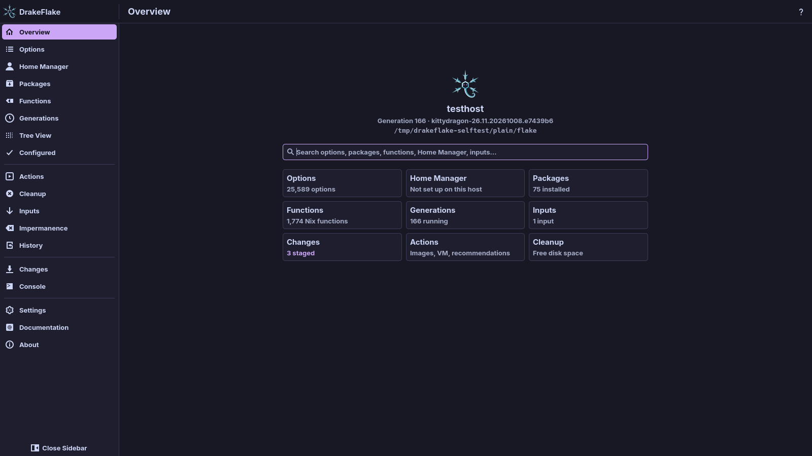

<p align="center">
  
</p>

<h1 align="center">DrakeFlake</h1>

<p align="center"><em>NixOS, tamed.</em></p>

<p align="center">
  <a href="https://github.com/dr460nf1r3/drakeflake/actions/workflows/ci.yml"></a>
  <a href="http://commitizen.github.io/cz-cli/"></a>
  <a href="https://github.com/dr460nf1r3/drakeflake/releases"></a>
</p>

DrakeFlake is a desktop app for NixOS and nix-darwin systems that are configured with a flake. With it you can:

- search all options of your system (nix-darwin's on a Mac), see their current value and change them,
- change the Home Manager settings of the users on your host,
- search packages from the nixpkgs your system uses, add them or try them without installing,
- check the inputs in your `flake.lock` for updates and update them,
- rebuild the system, go back to an earlier generation and free disk space.

The app never edits the files you wrote yourself. Your changes go into generated files inside your flake, which your
configuration imports once.



## Documentation

The user guide lives at
**[dr460nf1r3.github.io/drakeflake](https://dr460nf1r3.github.io/drakeflake/)**. Good places to start:

- [Installation and requirements](https://dr460nf1r3.github.io/drakeflake/installation.html)
- [First start: the setup assistant](https://dr460nf1r3.github.io/drakeflake/setup.html)
- [Reviewing and applying](https://dr460nf1r3.github.io/drakeflake/applying.html)
- [Troubleshooting](https://dr460nf1r3.github.io/drakeflake/troubleshooting.html)
- [Privacy and security](https://dr460nf1r3.github.io/drakeflake/security.html)

Its sources are in [`docs/`](docs/src/SUMMARY.md).

## Quick start

DrakeFlake needs NixOS on x86_64 or aarch64, or macOS on Apple silicon with nix-darwin, and a flake-based system
configuration.

### Run it from the flake

The repository is a flake, so you can run the app straight from it without installing anything:

```sh
nix run github:dr460nf1r3/drakeflake/stable
```

`stable` is a tag on the newest commit that passed CI (the Rust tests, the lints and the self-tests). It moves forward
after every commit to `main` that passes. Leave out `/stable` for the newest `main`, tested or not, or add
`?ref=<branch>` or `?rev=<commit>` instead to run another branch or an exact commit. `nix run` starts the app.
`nix shell` also puts the tray icon on your `PATH` (the root helper stays off it on purpose):

```sh
nix shell github:dr460nf1r3/drakeflake/stable -c drakeflake-tray
```

From a checkout of the repository, the same works with `.` as the flake:

```sh
nix run .
nix shell . -c drakeflake-tray
```

Run this way, the app works as installed, but its polkit actions are missing, so the password prompts are the generic
ones of `pkexec`.

### Install it

To install it, add this repository as an input of your system flake and put
`drakeflake.packages.${pkgs.stdenv.hostPlatform.system}.default` into `environment.systemPackages`. The
[installation guide](https://dr460nf1r3.github.io/drakeflake/installation.html) has the full example. A system-wide
install also brings the polkit actions that give the password prompts a clear description.

## Found any issue?

Please open an issue on this repository. Click
[here](https://github.com/dr460nf1r3/drakeflake/issues/new) to start. The log file at
`~/.local/state/drakeflake/drakeflake.log` helps a lot, and the
[troubleshooting page](https://dr460nf1r3.github.io/drakeflake/troubleshooting.html) explains the common problems.

## How to release a new version?

Versions are git tags in semantic versioning, written by commitizen from the commit history. The CI turns every new tag
into a GitHub release.

## License

DrakeFlake is free software, licensed under the [GNU General Public License v3.0 or later](LICENSE).
