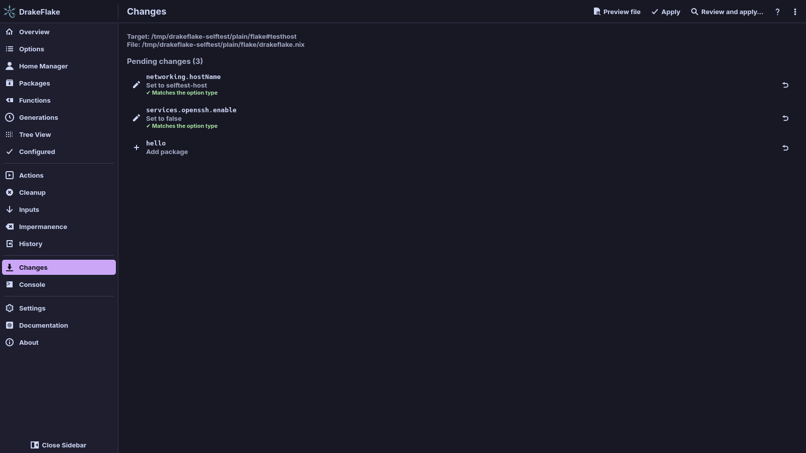
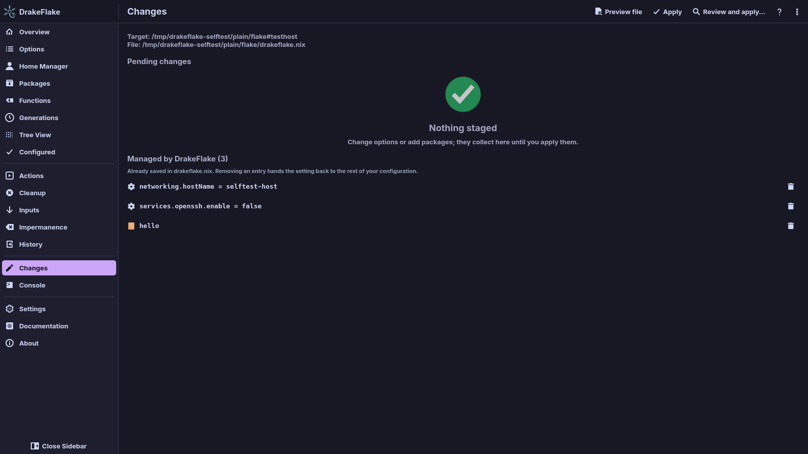
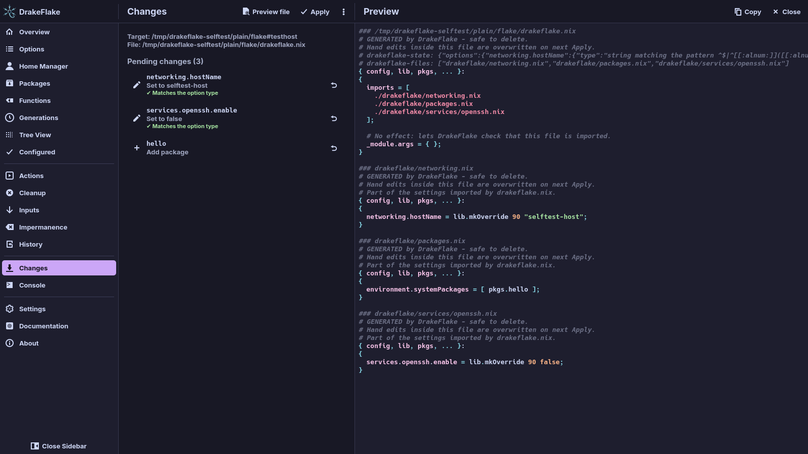
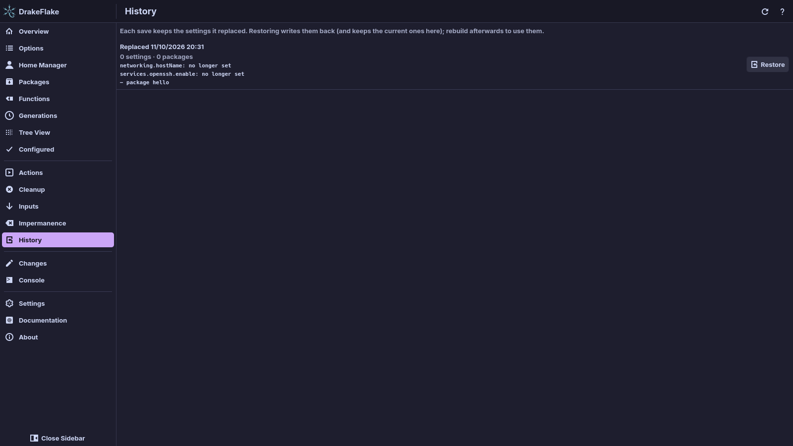

# Reviewing and applying

Every change you stage collects on the **Changes** page. From there you check
your changes, preview the files they produce and apply them to your system.
This page also covers the **Console**, git commits and the **History** page.

The sidebar entry shows the number of pending changes, for example "Changes
(3)". With nothing staged, the page says **Nothing staged**.

## Before you start

- Select a system in the [setup assistant](setup.md).
- Import the generated file in your configuration (see
  [the setup assistant](setup.md#3-import)). Without the import you can only
  save.

## Check your staged changes

The top of the page shows the system the changes are for (**Target:** flake and
host) and the generated entry file (**File:**).

### Pending changes

**Pending changes** lists each staged change:

- an option with its new value, for example "Set to true",
- a package to add or remove (**Add package**, **Remove package**),
- a setting to remove from the generated file.

Under each option you see its priority, input mode and host scope when they are
not the defaults, and the result of the type check. While the app checks the
values, a message says "Checking staged values against your configuration's
option types…".

- To see an option's details, click it.
- To unstage a change, click **Unstage** (the undo button) at the end of its
  row.

### Hand a setting back to your configuration

**Managed by DrakeFlake** lists what the generated file already sets. To hand a
setting back to the rest of your configuration, click **Remove** (the delete
button, tooltip **Stage removal**) next to it. This stages its removal. The
setting leaves the generated file when you apply.

### Warnings

Messages above the list warn you when something would keep your changes from
working:

- "Your configuration does not import … yet": add the import line (see
  [the setup assistant](setup.md#3-import)).
- "… is not tracked by git, so the flake cannot see it": click
  **Track in git**.
- The generated file is outside the flake, or the flake is not a local folder.
  When the selected system has a problem, the message has a **Settings**
  button that opens the settings.
- "… staged value(s) do not match their option type. Fix or unstage them to
  apply." You cannot apply until you do.

Each of these has an entry in [Troubleshooting](troubleshooting.md).

## Preview the generated files

To see the files exactly as they would be written, click **Preview file**. The
preview has syntax highlighting. With a split layout, each file starts with a
`### path` line. **Copy** copies the whole preview.

## Applying

To apply your changes, click **Apply** in the toolbar. The toolbar holds
**Preview file**, **Apply** and **Review and apply…**. The menu (⋮) at the end
of the toolbar holds the others.

> **Warning:** **Apply** changes the running system and asks for your password.
> To go back, switch to an earlier generation on the
> [Generations](maintenance.md#generations) page.

| Action                             | What it does                                                                                              |
| ---------------------------------- | --------------------------------------------------------------------------------------------------------- |
| **Apply**                          | Save the files, build the system and switch to it now. It also becomes the default at boot.               |
| **Review and apply…**              | Save the files, then let nh build, show what changes (packages, versions, size) and ask before switching. |
| **Review and apply on next boot…** | Like the above, but the new system becomes the default from the next boot on.                             |
| **Save only**                      | Write the files without rebuilding.                                                                       |
| **Save and test build**            | Write the files and build the system without activating it.                                               |
| **Apply until reboot (test)**      | Build and activate the new system now, without making it the default at boot.                             |
| **Apply on next boot**             | Build the system and make it the default from the next boot on.                                           |
| **Discard all**                    | Drop every staged change.                                                                                 |

> **Note:** **Discard all** does not ask first. The changes were never saved,
> so the **History** page cannot bring them back. Stage them again instead.

Which actions exist depends on the host (see [nix-darwin systems](darwin.md)):

- A nix-darwin host has no test or boot actions.
- A host of the other platform than this machine (a nix-darwin host on Linux, a
  NixOS host on a Mac) can only be saved. The page then says so, for example
  "This is a nix-darwin host. On this Linux machine it can only be saved.", and
  shows **Save only** in the toolbar.

### What happens when you apply

1. The app renders the generated files and checks their Nix syntax.
2. It refuses to rebuild if your configuration does not import the generated
   file. **Save only** still works.
3. It backs up the current entry file (see [History](#history-and-restoring)).
4. It writes the files. If it may not write to the flake folder (for example a
   root-owned `/etc/nixos`), it asks for your password and writes them with the
   helper.
5. It marks new files for git (`git add --intent-to-add`).
6. It builds the system as your user, with `nh os build` or, without nh,
   `nixos-rebuild build`.
7. It activates the built system as root through the helper, asking for your
   password.

Steps 6 and 7 are how a NixOS host is rebuilt when the privileged helper is
installed. In the other cases the build and activation run in one go:

- Without the helper, `nh os <mode>` builds and activates and asks for root
  itself.
- Without nh, `nixos-rebuild <mode>` runs as root through `pkexec`, `run0` or
  `sudo`.
- A nix-darwin host with nh builds as you with `nh darwin build`. Then one
  macOS administrator dialog runs a script that points the system profile
  at the new system and activates it.
- A nix-darwin host without nh runs `darwin-rebuild switch` as root after
  the macOS administrator dialog, so the build runs as root too.

### Follow the progress

The window switches to the **Console**, where you follow the output. While it
runs, the banner says **Working… output appears below.** and the status bar
shows "Applying changes…". Each step reports how it ended, so a successful
apply shows "Finished successfully." more than once. Activating the built
system runs quietly: the Console says "Activating the system (asks for
administrator rights)…" before the dialog opens and then only reports how it
ended. A failed activation shows what it wrote.

- When it worked, the output ends with "Finished successfully." and the banner
  says **Done.**
- When it failed, the banner says **Failed. Check the output below.** If the
  generated file can be put back, it adds "You can restore the previous file."
  and the console shows **Restore previous file**.

If applying fails, see [Troubleshooting](troubleshooting.md).

### Review and apply with nh

**Review and apply…** lets you see what a rebuild changes before you switch to
it. It needs nh.

1. Click **Review and apply…** in the toolbar.
2. The app opens the **Preview** with the generated file. Read it, then click
   **Apply…** to save and rebuild.
3. The app saves the files, builds the system and prints the package
   differences in the **Console**.
4. A bar with the question appears above the output. Click **Yes** to switch
   or **No** to stop.

For a nix-darwin host the app runs `nh darwin build`, prints the package
differences itself and asks the same question. Clicking **Yes** points the
system profile at the new system and activates it after one macOS
administrator dialog.

Without nh, the files are saved and the console says to use **Apply** instead.

## The Console

The **Console** shows the output of everything the app runs for you: builds,
updates, comparisons and cleanups. Each command is shown before its output.
Before anything runs, it says **No output yet**.

- **Cancel** stops the running command.
- **Copy** copies the whole output.
- **Clear** empties the console.
- **Restore previous file** appears after a failed apply. It puts the generated
  file back as it was before.

### Closing the window during a run

If you close the window while a command is running, the app asks **An
operation is still running. Quit anyway?** Closing would end the command in the
middle of its work, for example during a system activation.

- **Keep running** closes the question and leaves the window and the command
  alone.
- **Quit** cancels the command and closes the window once it has stopped, or
  after a few seconds at the latest.

Cancelling first sends Ctrl+C to the command, then asks it to terminate, and
only then kills it. Without a running command the window closes at once.

### Password prompts

Most password prompts are your desktop's polkit dialog (on a Mac the macOS
administrator dialog). When there is no setuid `pkexec`, the app uses `run0` or
`sudo` instead and says so in the console.

If such a program asks for your password in the console, a password bar appears
above the output:

1. Type your password.
2. Click **Send** or press Enter.

The password is passed to the program only. It is never shown or written to the
log, and the prompt line is hidden from the output.

See [Privacy and security](security.md) for what runs as root.

## Git

Flakes only see files that git tracks. When the app creates a new generated
file inside a git repository, it marks it with `git add --intent-to-add`. The
flake then sees it without you committing anything. If that fails, the Changes
page shows a warning with a **Track in git** button.

### Automatic commits

With **Commit the changes on apply** on (the default), every successful apply
commits all changes in the flake folder:

- The subject is `drakeflake: update config`. The body lists the changed
  settings and re-pinned inputs, for example `- nixpkgs: 1a2b3c4 -> 5d6e7f8`.
- A flake without a git repository gets one first.
- In a larger repository, only the flake folder is committed.
- Without a git name and email, the author is
  `DrakeFlake <drakeflake@your-hostname>`.

Nothing is committed when the rebuild fails, and nothing is ever pushed. If git
refuses (for example in a root-owned `/etc/nixos`), the console shows a
warning. To commit yourself, switch it off in [Settings](settings.md#applying)
under **Applying**.

## History and restoring

Every save keeps the settings it replaced. The **History** page lists these
earlier states, newest first. For each one it shows:

- when it was replaced ("Replaced …"),
- how many settings and packages it holds,
- what restoring it would change. A long list ends with "… and … more".

A state that matches the current settings says **Same as now** and cannot be
restored. **Refresh** reads the list again. Before the first save the page says
**No earlier settings yet**.

To go back to an earlier state:

1. Open the **History** page.
2. Click **Restore** on the state you want. The app writes those settings back
   and keeps the current ones in the history. The window switches to the
   **Console**.
3. Rebuild to use them, for example with **Apply** on the Changes page.

> **Note:** **Restore** does not ask first. It only writes the generated file,
> so your running system changes only when you rebuild. To undo a restore,
> restore the state it replaced.

The backups are stored outside the flake, in
`~/.local/state/drakeflake/backups/` (or under `$XDG_STATE_HOME` when it is
set). They are never imported or committed.

## Related

- [Generations, cleanup and actions](maintenance.md)
- [nix-darwin systems](darwin.md)
- [Privacy and security](security.md)
- [Troubleshooting](troubleshooting.md)
