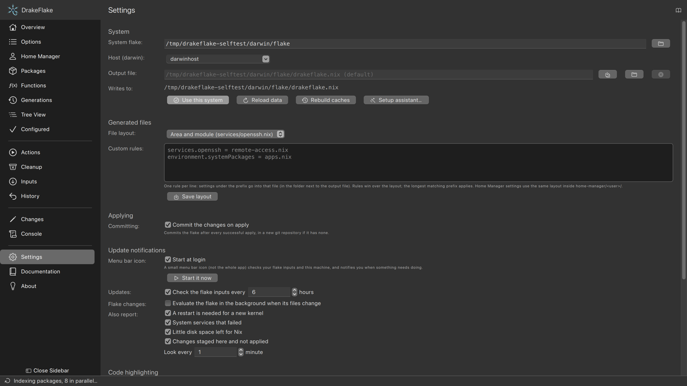
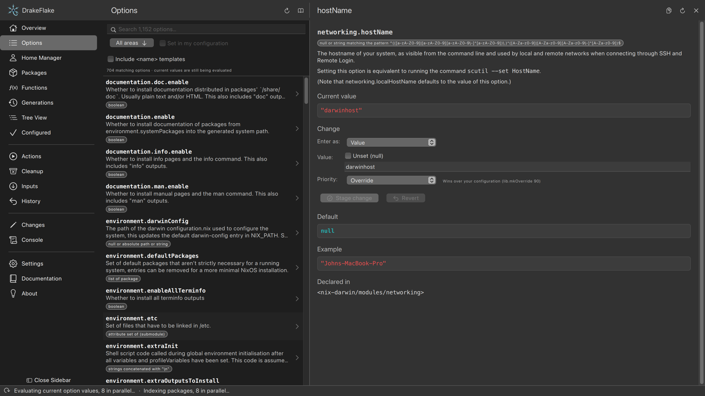
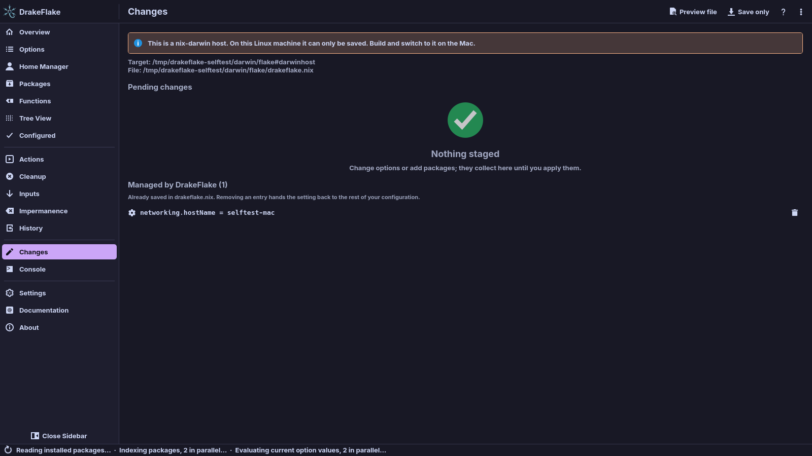

# nix-darwin systems

DrakeFlake manages nix-darwin hosts the same way it manages NixOS ones. Pick a
flake with `darwinConfigurations`, edit its options and packages, and apply.
With nh the app builds as you, then one administrator dialog activates the
result. Without nh, `darwin-rebuild switch` runs as root. See
[Reviewing and applying](applying.md).

A flake can hold both kinds of hosts. The host label in Settings shows the kind
of the selected host, for example "Host (darwin):".



## What works

Options, packages, Home Manager users, inputs, history and the console work as
on NixOS. Home Manager is imported as a `darwinModules` module, with the users
under the same `home-manager.users.<name>`.



nix-darwin has no equivalent for these, so they are left out:

- image building (`system.build.images`)
- the Test and Boot modes
- the tray's kernel and failed-service checks (their boxes stay in Settings
  but report nothing)

## Applying on a Mac

On a Mac, applying builds the system and then activates it.

- Root rights come from the macOS administrator dialog. It says "DrakeFlake
  wants to run as administrator" and shows the command it is about to run.
- With nh installed, applying builds the system as you and the dialog opens
  once. That one approval points the system profile at the new system and
  activates it.
- Without nh, `darwin-rebuild switch` runs the whole switch as root after
  the same dialog.
- **Review and apply…** shows the package differences and asks for
  confirmation in the Console first. Then the same single dialog activates.
- Applying also writes generated files you cannot write yourself, for example
  in a root-owned `/etc/nix-darwin`. That is a separate dialog.

> **Note:** The activation has root rights but not Full Disk Access. Options
> that write files macOS protects with it, such as `system.defaults.smb.*`,
> make the activation fail. See
> ["Could not write domain" when applying on a Mac](troubleshooting.md#could-not-write-domain-when-applying-on-a-mac).

## Appearance

On a Mac the app uses the native macOS controls style instead of Breeze. It
follows the system light and dark appearance, including the code views and the
console palette (unless Settings pins a highlighting theme). The icons are the
system's SF Symbols. They are drawn once at start, so after you switch between
light and dark, restart the app to update them.

Colours and fonts come from the running macOS:

- text and backgrounds use the system colours
- selections, focus rings and links follow the accent colour you chose
- the system red, orange and green mark errors, warnings and success
- they change with System Settings → Appearance while the app runs

The window is translucent, so the desktop behind it shows through blurred, as
in other Mac apps:

- The native titlebar is transparent over the same blur. The content flows
  under it, with the traffic lights floating over the sidebar.
- The window uses the system sidebar material. On macOS 26 and later, macOS
  renders it in the Liquid Glass style. Older systems show the sidebar blur.
- With "Reduce transparency" turned on in the Accessibility settings, macOS
  draws the window solid instead.
- The sidebar and the toolbars have no separating lines, like native Mac
  windows. The status bar shows one only while a task runs.

## Dock and notifications

While changes are staged, the Dock icon shows their number. When a rebuild
finishes while the app sits in the background, the app asks macOS to bounce
the icon as a critical request. It does nothing while the app is active.

## Hosts of the other platform

A host can only be built and activated on the kind of system it describes. The
other kind can still be edited and saved:

| DrakeFlake runs on | NixOS host | nix-darwin host       |
| ------------------ | ---------- | --------------------- |
| NixOS (Linux)      | everything | save only             |
| macOS              | save only  | build, switch, review |

To apply a save-only host:

1. Open the Changes page. It says the host is save-only.
2. Click **Save only** in the toolbar. The rebuild buttons and the Overview's
   rebuild actions are hidden for this host.
3. Copy or push the flake to the other machine and apply it there.



Generations (compare and switch), Cleanup and the Recommendations on the
Actions page work for nix-darwin hosts too. See
[Generations, cleanup and actions](maintenance.md).

## Installing on a Mac

The package for `aarch64-darwin` contains:

- `DrakeFlake.app`, in `Applications/` of the package. Link or copy it into
  `/Applications`.
- the `drakeflake` command
- the menu bar icon `drakeflake-tray-macos` (see
  [Update notifications](inputs.md#update-notifications-in-the-tray))
- in `libexec/`, the helper and `drakeflake-elevate`, which shows the
  administrator dialog

## Flake layout

On a Mac the setup assistant looks in `/etc/nix-darwin` first. A minimal flake
looks like this:

```nix
{
  inputs.nix-darwin.url = "github:nix-darwin/nix-darwin/master";
  outputs =
    { nix-darwin, ... }:
    {
      darwinConfigurations.my-mac = nix-darwin.lib.darwinSystem {
        system = "aarch64-darwin";
        modules = [ ./configuration.nix ];
      };
    };
}
```

> **Tip:** Keep nix-darwin and nixpkgs on matching releases. nix-darwin refuses
> to evaluate against an older or newer nixpkgs than its own.

## Related

- [Settings](settings.md)
- [Privacy and security](security.md)
- [Generations, cleanup and actions](maintenance.md)
