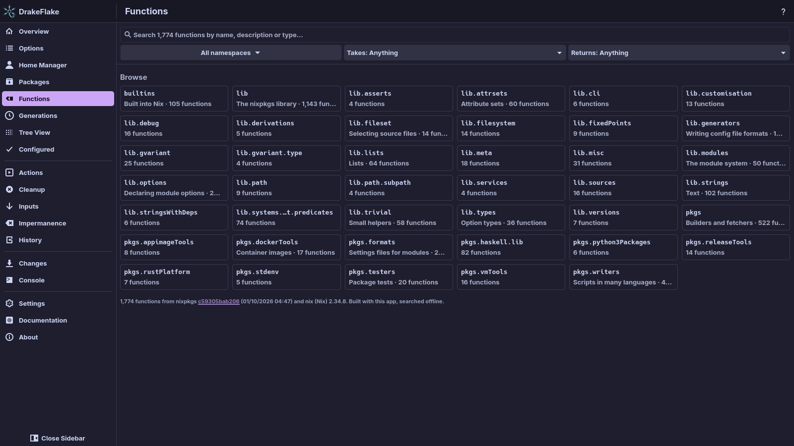
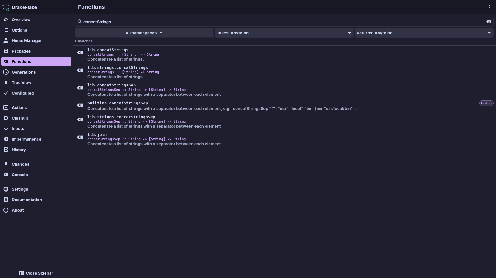
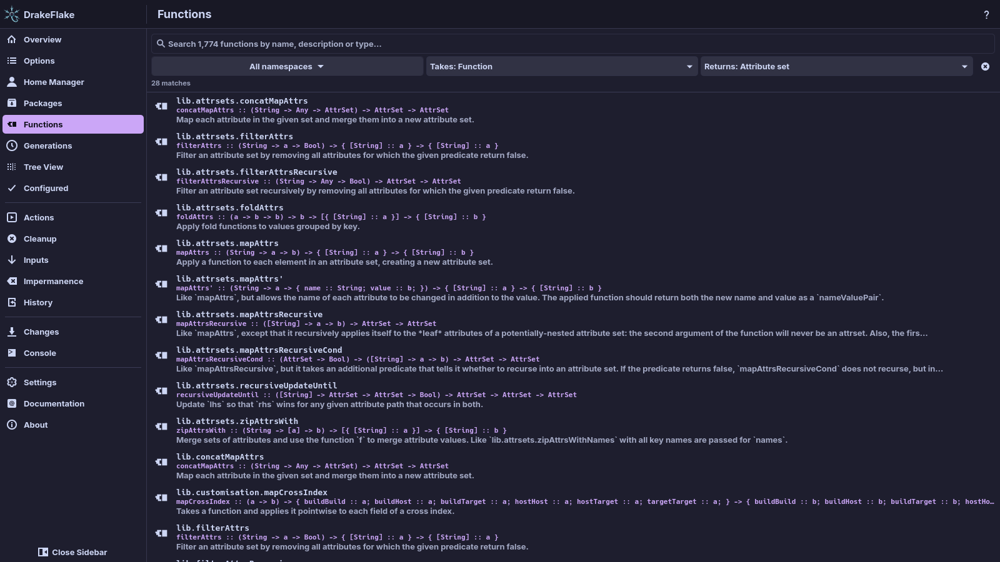
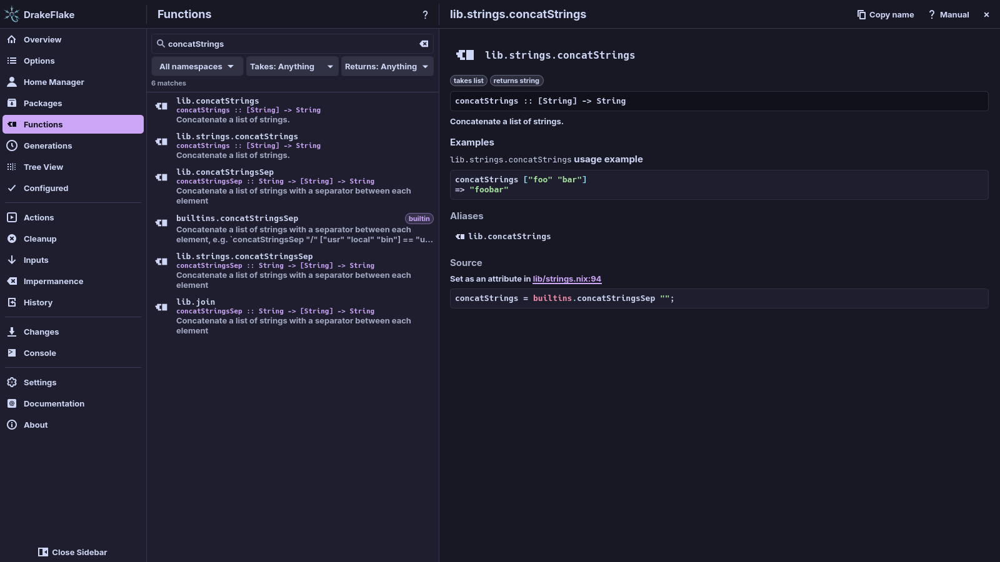

# Nix functions

Use the **Functions** page to look up Nix functions, like
[noogle.dev](https://noogle.dev), but offline. It lists:

- the nixpkgs library (`lib`, for example `lib.strings.concatStrings` or
  `lib.mkIf`), including `nixos/lib`
- the functions built into Nix (`builtins.map`, `builtins.fetchGit`, …)
- the builders and helpers in `pkgs`: `pkgs.writeShellApplication`,
  `pkgs.runCommand`, `pkgs.formats.toml`, `pkgs.writers`, `pkgs.dockerTools`,
  `pkgs.testers` and more

The index is built together with the app, from the nixpkgs the app was built
with. That is why searching needs neither Nix, a selected system nor the
network. The line at the bottom of the overview says which nixpkgs commit and
Nix version the index comes from.

## Browse by namespace

Without a search, the page shows the **Browse** overview: a card for each
namespace (`lib.strings`, `lib.lists`, `builtins`, `pkgs.writers`, …) with a
short description and the number of functions.

To list a namespace's functions, click its card. This sets the namespace filter
(see [Filters](#filters)).

The search on the **Overview** page finds functions too, in their own group.
**All … in Functions** opens this page with the same search.

## Find a function

1. Open **Functions**.
2. Type a name, a word from the description or a type. The search also looks
   at the documented type, so `string -> list` finds functions such as
   `lib.strings.splitString`.
3. Read the results. Each row shows the function's path, its type and the
   first sentence of its documentation. Functions built into Nix carry a
   **builtin** tag.
4. If the list ends with **Show more (… left)**, click it to see more results.

If nothing matches, the page shows **No matching functions**. The filters may
hide what you look for.

### Filters

The row below the search field has three filters:

- **All namespaces**: search only below one namespace, for example
  `lib.attrsets`. Type into **Filter namespaces…** to find one. The number
  after each name counts the functions below it.
- **Takes: …** and **Returns: …**: the kind of the first argument and of the
  result, read from the function's documented type. The kinds are
  **String**, **Number**, **Boolean**, **Path**, **List**, **Attribute set**,
  **Function**, **Derivation** and **Null**. **Any type (a, b, …)** matches
  type variables such as `a`.

Functions without a documented type only show while both type filters are set
to **Anything**.

While a filter is set, the **Clear filters** button at the end of the row
resets all three. Clear the search field as well to get the overview back. The
number of matches is shown below the row.

For example, **Takes: Function** with **Returns: Attribute set** lists
`lib.attrsets.mapAttrs` and its relatives.

## Read a function's details

Click a function to open its details next to the list. They show:

- its type
- tags:
  - **built into Nix** for builtins
  - **experimental: …** with the experimental Nix feature it needs
  - **impure evaluation only** for functions that only work in impure
    evaluation
  - **takes …** and **returns …** with the kinds from its type
- **Arguments: …** with the names of its arguments, when known
- the documentation, with highlighted examples. Links to other functions open
  them here. Other links open in the browser. Without documentation, the page
  says **This function has no documentation comment.**
- **Aliases**: other paths to the same function, for example
  `lib.concatStrings` for `lib.strings.concatStrings`. An alias without
  documentation of its own shows the documentation of the function it refers
  to, and says so.
- **Source**: the file and line in nixpkgs (a link to that line on GitHub), the
  place where an alias is set, and the definition itself

The toolbar has:

- **Copy name**, which copies the function's path
- **Manual**, for `lib` and `builtins`, which opens the function in the online
  nixpkgs or Nix manual
- **Close**

## What is documented

Documentation comes from the source:

- for nixpkgs functions, the `/** … */` comment before the function
- for builtins, the documentation compiled into Nix
- some builders in `pkgs` only have a plain comment, which is shown instead, or
  none
- functions that only wrap others (such as everything made with
  `makeOverridable`) show the comment at their attribute

## For developers

The package builds the index as a derivation of its own (`.#function-index`)
and links it to `share/drakeflake/functions.json`.

A development build looks for it at `target/share/drakeflake/functions.json`.
`cargo build` does not create it. Without an index the page shows
**The function index is not installed** and says where it expected it. To
create one, do one of these:

- Run `scripts/dev.sh`. It creates the index on its first run.
- Run `scripts/function-index.sh` yourself.
- Point `DRAKEFLAKE_FUNCTION_INDEX` at an index file.

## Related

- [Overview and search](overview.md)
- [Searching and changing options](options.md)
- [Packages](packages.md)
