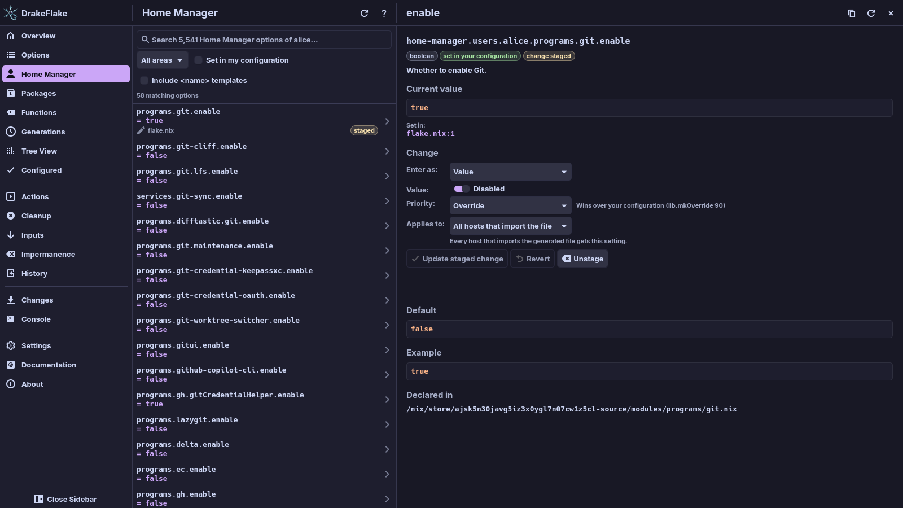

# Home Manager

Use the **Home Manager** page to search and change the Home Manager options of
the users on your host. The sidebar always has this entry. It lists options
only when your host uses Home Manager as a NixOS (or nix-darwin) module.

## Before you start

- Select a system. Without one, the page shows **No system selected**.
- Import Home Manager as a system module in your host configuration:
  - `home-manager.nixosModules.home-manager` on NixOS
  - `home-manager.darwinModules.home-manager` on nix-darwin
- Set up your user in `home-manager.users.<name>`, for example
  `home-manager.users.alice`.

The app does not manage a standalone Home Manager setup (with its own
`home-manager switch`). It only sees Home Manager through your system
configuration, so a standalone setup does not show here.

### What the page shows instead of options

| State                               | Page                                        | Card on the Overview        |
| ----------------------------------- | ------------------------------------------- | --------------------------- |
| The app is reading the host         | **Checking for Home Manager…**              | **Checking…**               |
| Home Manager is not imported        | **Home Manager is not set up on this host** | **Not set up on this host** |
| The check failed                    | **Could not check for Home Manager**        | **Could not check**         |
| The configuration does not evaluate | **Could not evaluate your configuration**   |                             |
| The options are being read          | **Reading Home Manager options…**           |                             |

When Home Manager is not set up, the page also explains what to import. When a
check fails, see [Troubleshooting](troubleshooting.md).

## Find and change a Home Manager option

The page works like the [Options](options.md) page. It has a search field, the
area filter, **Set in my configuration** and **Include `<name>` templates**.
Rows show **managed** for options the generated file sets and **staged** for
options with a pending change.

Names are shown relative to the user. You see `programs.git.enable` instead of
`home-manager.users.alice.programs.git.enable`.

1. If several users have Home Manager, choose the user in the list above the
   search field. The list only appears with more than one user.
2. Search for the option, for example `git`.
3. Click the option to open its details.
4. Choose a value or a Nix expression, a priority and, if needed, the host.
   This works exactly as described in
   [Change an option](options.md#change-an-option).
5. Click **Stage change**.

The change then waits on the **Changes** page, like any other staged change.
Apply it there (see [Reviewing and applying](applying.md)).

To browse Home Manager options as a tree, open **Tree View** and choose
**Home Manager options** in its dropdown (see
[Browse all options as a tree](options.md#browse-all-options-as-a-tree)).

## Reload the host

To read your host again, for example after you imported Home Manager or added
a user, click **Refresh** at the top of the page. It is an icon button with the
tooltip "Re-evaluate options and values".

- It reloads the whole host, the same as **Refresh** on the **Options** page.
- It checks again whether Home Manager is set up, then re-evaluates options and
  values.
- It does the same as **Reload data** in [Settings](settings.md#system). It
  keeps the cached indexes. To evaluate everything from scratch, use
  **Rebuild caches** there.
- It is disabled while the app is busy.

## Where the settings go

Home Manager settings are written into the same generated files as your NixOS
settings, as `home-manager.users.<name>.…`. They are applied with the next
system rebuild, because Home Manager runs as part of your system configuration.

With a split layout they go into a `home-manager/<name>/` folder next to the
other parts, using the same layout inside it.

## Related

- [Searching and changing options](options.md)
- [Reviewing and applying](applying.md)
- [nix-darwin systems](darwin.md)
