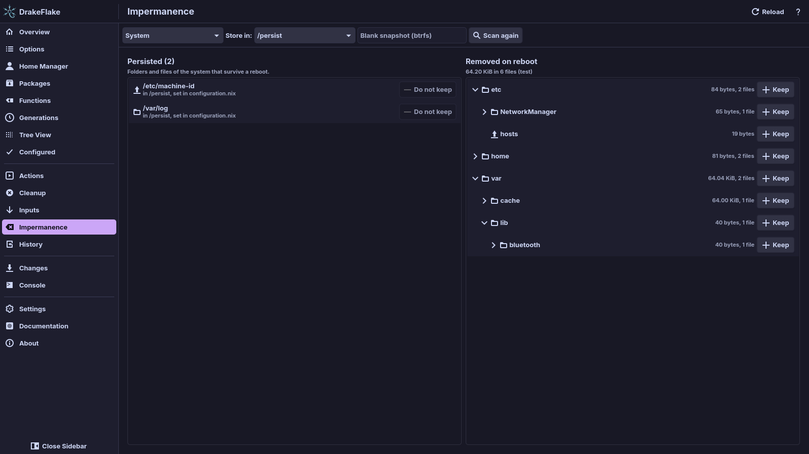

# Impermanence

On an impermanent NixOS system the root file system is wiped on every boot.
Only the folders and files you list in the impermanence module survive. The
**Impermanence** page shows both sides next to each other: what your host keeps
and what a reboot removes. To keep something, or to stop keeping it, move it
to the other side. The page stages the change like any other setting.

## Before you start

- Your flake imports the
  [impermanence module](https://github.com/nix-community/impermanence)
  (`impermanence.nixosModules.impermanence`). Without it the page says
  **This host does not use impermanence**.
- The host has at least one persistent storage location, for example
  `environment.persistence."/persist"`. New entries go to one of them.
- The page is for NixOS. On a Mac it is not in the sidebar.

## See what your host keeps

The left list shows every persisted folder and file, read from your flake's
evaluated configuration. Each row shows the path on the running system and the
storage location it is kept in. A folder keeps everything inside it.

The second line of a row says where the entry is set:

| Text                                     | Meaning                                                                                       |
| ---------------------------------------- | --------------------------------------------------------------------------------------------- |
| "in /persist, set by DrakeFlake"         | The entry is in the generated file. You can move it.                                          |
| "in /persist, set in hosts/base.nix"     | Your own file sets it. To drop it, remove it there. The page cannot change your files.        |
| "in /persist, set in your configuration" | Your configuration sets it, but the app cannot name the file (for example inside `lib.mkIf`). |

To read the configuration again, for example after you edited your own files,
click **Reload**.

The entries are kept until the configuration changes, so the page opens at once
after the first read. A changed configuration is read again.

## See what a reboot removes

1. Click **Scan**. The polkit dialog says "Authentication is required to list
   the files a reboot removes from the root file system".
2. The right list, **Removed on reboot**, shows the folders and files on the
   root file system with their size. Click a folder to open it.

The scan reads names and sizes only, never the contents of a file. It needs
the administrator password because most of `/etc`, `/var` and `/root` is not
readable for your user. It skips:

- other file systems mounted below `/`, so persisted folders that are bind
  mounted from `/persist` do not show up,
- `/nix`, `/proc`, `/sys`, `/dev` and `/run`,
- everything the left list keeps, staged entries included.

Large trees are shortened: deep levels and the smallest entries of a big
folder are not listed one by one. They still count in the size of their
folder, and you can move the folder as a whole.

To list the root file system again, click **Scan again**. If the scan fails,
see [The scan of the root file system fails](troubleshooting.md#the-scan-of-the-root-file-system-fails).

### tmpfs and btrfs

The header of the list names the file system of `/`:

- `tmpfs`: everything on it is gone after a reboot. The list is complete.
  The **Blank snapshot (btrfs)** field is hidden.
- `btrfs` with a rollback: the boot restores a blank snapshot. Files in that
  snapshot come back. The **Blank snapshot (btrfs)** field appears only on a
  btrfs root. Type the name of the snapshot subvolume into
  **Blank snapshot (btrfs)**, for example `root-blank`, and click **Scan**.
  The list then leaves out what the snapshot holds and says "compared with the
  blank snapshot".

To read the snapshot, the helper mounts the top level of the btrfs file system
read-only in a mount namespace of its own. No other program sees that mount,
and it is gone when the scan ends.

## Keep a folder or file

1. Click **Scan** if the right list is empty.
2. Optional: pick the storage location in **Store in:**, for example
   `/persist`.
3. In **Removed on reboot**, find the folder or file, for example
   `/var/lib/bluetooth`.
4. Click **Keep** at the end of its row. The tooltip says whether it keeps a
   folder or a file.

The entry moves to the left list with the tag **staged**. The change is
`environment.persistence."/persist".directories` (or `.files` for a file),
which you find on the **Changes** page. Apply it like any other change (see
[Reviewing and applying](applying.md)).

The generated file only adds to the lists your own files define. The module
merges both, so your own entries stay as they are.

> **Note:** A new entry takes effect with the next boot. Copy anything you
> want to keep into the storage location first, for example
> `/persist/var/lib/bluetooth`. Otherwise the folder starts empty.

## Stop keeping a folder or file

1. In the left list, find an entry that says "set by DrakeFlake".
2. Click **Do not keep** at the end of its row. The tooltip says that it is
   removed on the next reboot.

The entry gets the tag **staged removal**. To undo that before you apply,
click **Keep it**. Entries set in your own files have no active button. Remove
them in the file the row names.

> **Warning:** After you apply this and reboot, the folder or file is removed
> from the root file system. Its copy in the storage location stays until you
> delete it.

## Home Manager users

When the host uses Home Manager, pick the user in the first box, for example
**Home Manager: alice**. Both lists then show only that user's home folder:

- The left list shows the user's entries from Home Manager's
  `home.persistence` and from `environment.persistence.<storage>.users`.
- The right list starts at the home folder, for example `/home/alice`.

Moving an entry writes it relative to the home folder, for example `.config`,
to `home-manager.users.alice.home.persistence."/persist".directories`. When the
user's Home Manager configuration does not have `home.persistence`, the page
writes to `environment.persistence."/persist".users.alice` instead.

To go back to the whole system, pick **System**.

## Related

- [Searching and changing options](options.md)
- [Home Manager](home-manager.md)
- [Reviewing and applying](applying.md)
- [Privacy and security](security.md)
