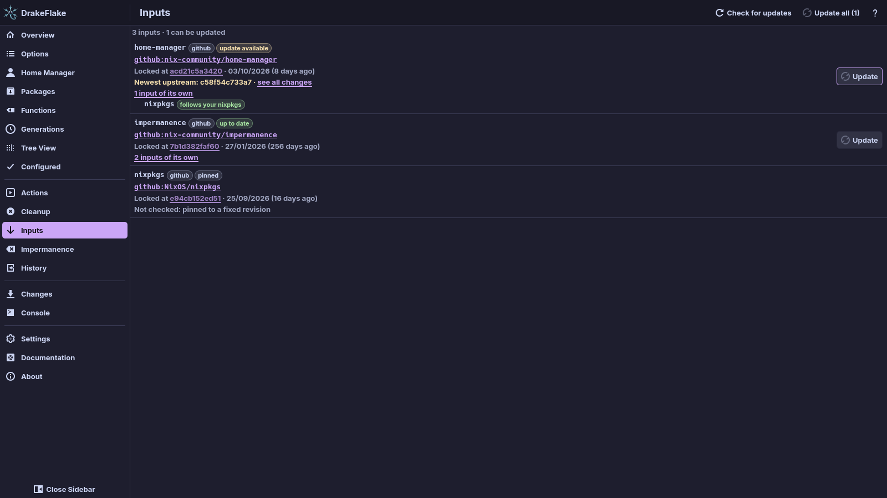

# Flake inputs

The **Inputs** page lists the inputs of your system flake from `flake.lock`.
For each input you see where it comes from, which revision it is locked to,
when that revision was made, and whether upstream has something newer. From
here you update your inputs and set up update notifications.



## Check for updates

Opening the page asks each source for its newest revision. To ask again, click
**Check for updates**. The check takes a few seconds and needs the network. It
uses `git ls-remote` for git and GitHub sources and the HTTP headers of tarball
sources.

The header counts your inputs and says how many can be updated, for example
"5 inputs · 2 can be updated". Each row shows the locked revision and its date
("Locked at …"). A flake without inputs or without a lock file shows
**No flake inputs**. If `flake.lock` cannot be read, the page says
**Cannot read flake.lock**.

Each input gets a tag:

| Tag                  | Meaning                                                                                                                                                |
| -------------------- | ------------------------------------------------------------------------------------------------------------------------------------------------------ |
| **update available** | Upstream has a newer revision. The row shows "Newest upstream: …" and, where the source supports it, a **see all changes** link to the comparison.     |
| **up to date**       | The locked revision is the newest.                                                                                                                     |
| **pinned**           | The input is locked to a fixed revision in `flake.nix`. There is nothing to update.                                                                    |
| **check failed**     | The source could not be asked. The row shows "Could not check: …" with the reason. Private repositories fail the check rather than ask for a password. |

Some inputs cannot be checked at all: a local path or git repository, a flake
registry entry, or a tarball server without version headers. They get no tag.
The row says "Not checked: …" with the reason.

An input that follows another one ("Follows the input …") is locked together
with that input.

### Inputs of inputs

To see the inputs that an input brings along, click a row that says "… inputs
of its own". Each one is tagged:

| Tag               | Meaning                                                               |
| ----------------- | --------------------------------------------------------------------- |
| "follows your …"  | It uses your input of that name.                                      |
| "same as your …"  | It shares the locked copy of one of your inputs.                      |
| "follows …"       | It follows another input.                                             |
| **separate copy** | It brings a second copy of a repository you already have as an input. |
| **own copy**      | It brings its own copy of something you do not have.                  |

For a separate copy, the app suggests the `follows` line that avoids the second
copy, for example `inputs.home-manager.inputs.nixpkgs.follows = "nixpkgs";`.

## Update your inputs

- To update one input, click **Update** in its row. Pinned inputs and inputs
  that follow another one have no **Update** button.
- To update everything, click **Update all** at the top. It shows how many
  inputs can be updated, for example "Update all (2)".

> **Note:** An update only changes `flake.lock`. Your system keeps running the
> old versions until you rebuild.

The update runs as your user, with the output in the **Console**. It runs
`nix flake update`, or `nix flake lock` when every input has a known newer
version (see
[Why updates use the newest known revision](#why-updates-use-the-newest-known-revision)).
**Cancel** stops it, for example when a download hangs. If the update fails,
the page shows an error that points you to the **Console** for details (see
[Troubleshooting](troubleshooting.md)).

If your user may not write `flake.lock` (for example in a root-owned
`/etc/nixos`), the new lock file is written to a temporary file first. The
helper then puts it in place and asks for your password. The polkit dialog
says "Authentication is required to save the updated flake.lock". On a Mac it
is the administrator dialog. The update itself never runs as root.

### Rebuilding after an update

When the update succeeds, the page says "flake.lock was updated. Rebuild to
start using the new versions." It offers two buttons:

- **Rebuild and switch** builds the system and switches to it.
- **Build only** builds the system without switching to it.

A rebuild from here uses your configuration as it is. It does not write the
generated files. For a host of the other platform than this machine, the page
says to rebuild on the machine the host runs on and shows no buttons. If you
watched the update in the **Console**, the same buttons wait there once it
reports done.

### Why updates use the newest known revision

A plain `nix flake update` asks GitHub's API for the newest revision of a
branch. When that API's rate limit is reached, Nix prints "using cached
version", keeps the old revision and still reports success.

To avoid this, the update checks upstream again. It locks every input whose
newer revision it finds directly to that revision with `--override-input`. This
keeps the original reference, such as `github:NixOS/nixpkgs/nixos-unstable`, in
`flake.lock`.

This works for tarball inputs and for GitHub, GitLab and SourceHut inputs that
name only the repository and a branch. All other inputs are left to
`nix flake update`.

After the update the app compares `flake.lock` with what it expected. If an
input did not reach the new revision, the console says "Not updated: … Nix kept
its cached version". See
[An input was not updated](troubleshooting.md#an-input-was-not-updated).

### GitHub API rate limit

GitHub allows only a small number of anonymous API requests per hour. If your
updates keep hitting the limit, give Nix a GitHub access token in `nix.conf`. A
token without extra permissions is enough for public repositories:

```ini
access-tokens = github.com=ghp_yourtokenhere
```

Put it in a file only you can read, for example `~/.config/nix/nix.conf`. Do
not put it in your system configuration, because that ends up in the
world-readable Nix store.

## Update notifications in the tray

`drakeflake-tray` is a small tray icon (not the whole app) that checks your
flake inputs for updates. It checks two minutes after it starts and then every
six hours. You can change both the check and the interval (see
[Choosing what the tray reports](#choosing-what-the-tray-reports)).

When updates are available, it changes its icon and shows a desktop
notification ("Flake updates available") naming the inputs. It notifies again
only when the list of updatable inputs changes. Only one tray runs per session.

On Linux the icon stays passive, so your tray may tuck it into its overflow
area. It asks for attention only when there is something to update or one of
the [reports about this machine](#reports-about-this-machine) needs you. To open
the app, click the icon.

### What the tray says

The tray sums up the last check in one line:

| Summary                                 | When                                    |
| --------------------------------------- | --------------------------------------- |
| "Checking for updates…"                 | A check is running.                     |
| "Could not check for updates: …"        | The check failed. The reason follows.   |
| "Updates available: …"                  | Inputs can be updated. They are named.  |
| "Your flake inputs are up to date."     | The last check found nothing to update. |
| "Checks your flake inputs for updates." | No check has run yet.                   |

On Linux the tooltip shows this summary followed by the reports about this
machine. On a Mac the tooltip shows "DrakeFlake: " and the summary.

### The tray menu

The menu lists each input that can be updated with the age of its locked
version, for example "nixpkgs — locked 9 days ago". Choosing one opens the
changes since then in your browser (or the input's repository). Below follow
"Open DrakeFlake", "Check for updates now" and "Quit".

### Reports about this machine

Every minute the tray also looks at a few things on this machine and lists them
at the top of its menu:

- "Restart to finish the update (new kernel)": the system was switched to a new
  kernel, initrd or kernel modules, which only take effect after a restart
  (NixOS).
- "Failed services: …": system services that are in the failed state, for
  example after a switch (`systemctl --failed`, NixOS).
- "Low disk space: … free for Nix": less than 5 GiB, or less than a tenth of
  the disk, is free for the Nix store. Cleanup in the app frees space.
- "… changes staged in DrakeFlake, not applied": edits you made in the app and
  have not saved yet, for any system.

The first three change the icon and show a notification once when they appear
("Restart needed", "Services failed", "Low disk space"). Staged changes are only
listed. `--check-once` prints these lines too.

### Choosing what the tray reports

Open **Settings** → **Update notifications** to decide what the tray does:

| Setting                                                   | What it controls                                                          |
| --------------------------------------------------------- | ------------------------------------------------------------------------- |
| **Updates:** **Check the flake inputs every** … hours     | Whether the tray checks for updates, and how often (1 to 168, default 6). |
| **Also report:** **A restart is needed for a new kernel** | The restart report.                                                       |
| **Also report:** **System services that failed**          | The failed services report.                                               |
| **Also report:** **Little disk space left for Nix**       | The disk space report.                                                    |
| **Also report:** **Changes staged here and not applied**  | The staged changes report.                                                |
| **Look every** … minutes                                  | How often the tray checks this machine (1 to 60, default 1).              |

The tray picks up changes within a minute. They are stored in the same settings
file as the rest, under `[tray]`:

```toml
[tray]
updates = true
check_hours = 6
health_minutes = 1
restart = true
failed_services = true
low_space = true
staged = true
watch_flake = false
```

### Evaluating when the flake changes

The tray can keep the options and values of your flake up to date.
Turn on **Evaluate the flake in the background when its files change** in
[Settings](settings.md#update-notifications), or tick
**Evaluate in the background when the flake changes** in the setup assistant.
It is off by default.

With it on, the tray watches the folder of the flake. When files change and
stay quiet for 30 seconds, it compares the flake's content hash with the last
evaluation. Only a changed hash starts an evaluation. The evaluation writes the
same cache the app reads, so the app opens with current data.

On Linux the evaluation runs at the lowest CPU priority, so your work keeps its
speed. It does not lower the disk priority, so a large evaluation can still slow
disk-heavy work. On a Mac it runs at the normal priority. Changes in hidden
folders and in `result` and `target` do not count. It needs the tray to run (see
[Starting the tray](#starting-the-tray)), and the app shows the result the next
time the app loads the flake (**Refresh** or a restart).

### Starting the tray

1. Open **Settings** → **Update notifications** (**Tray icon:**, on a Mac
   **Menu bar icon:**).
2. Turn on **Start at login**. This writes an autostart entry
   (`~/.config/autostart/drakeflake-tray.desktop`). Turning it off removes it.
3. To start the tray right away, click **Start it now**.

The tray checks the same flake as the app (from the app's settings). It only
works for a flake in a local folder.

### The tray on a Mac

On a Mac the tray is a menu bar icon, `drakeflake-tray-macos`, with the same
checks and menu (there the entry is "Check for Updates Now"). The differences:

- Clicking the icon opens its menu. To open the app, choose "Open
  DrakeFlake".
- The first line of the menu is the summary of the last check.
- The icon is always shown. It changes when something needs you.
- Notifications come through macOS's notification centre with a sound. They
  show as coming from Script Editor, because the app is not signed.
- **Start at login** writes a launch agent,
  `~/Library/LaunchAgents/org.dr460nf1r3.drakeflake.tray.plist`.

### Testing the check

To test the check from a terminal, run `drakeflake-tray --check-once` (on a Mac
`drakeflake-tray-macos --check-once`). It runs one check without starting the
tray, prints the result and exits:

| Output                 | Exit code | Meaning                               |
| ---------------------- | --------- | ------------------------------------- |
| `up to date`           | 0         | Nothing to update.                    |
| `updates available: …` | 0         | The named inputs can be updated.      |
| `error: …`             | 1         | The check failed. The reason follows. |

The [reports about this machine](#reports-about-this-machine) follow on their
own lines.

## Related

- [Reviewing and applying](applying.md)
- [Generations, cleanup and actions](maintenance.md)
- [Settings](settings.md)
