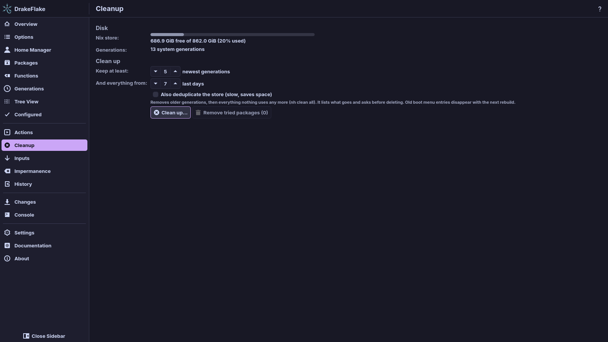
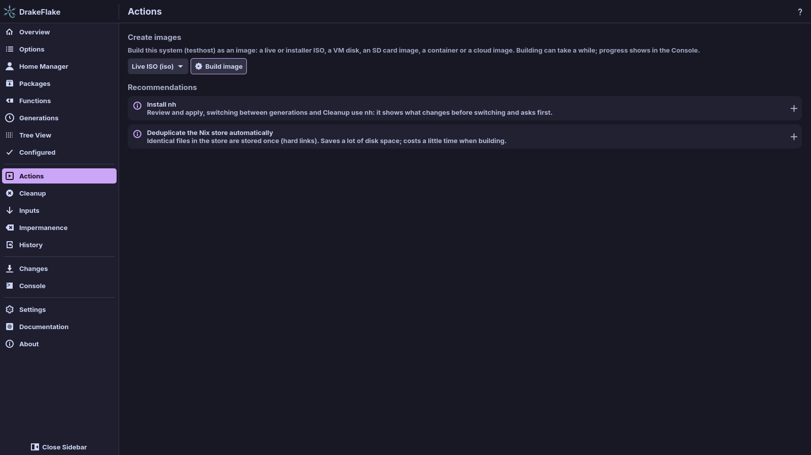

# Generations, cleanup and actions

This page covers three pages of the app: **Generations** (go back to an
earlier system), **Cleanup** (free disk space) and **Actions** (build images
and follow recommendations).

## Generations

Every rebuild creates a generation of your system. The **Generations** page
lists them (read from `/nix/var/nix/profiles`), newest first. Each row shows
"Generation …" with its date, NixOS version, kernel and specialisations
("Specialisations: …"). **Refresh** reads the list again. If there are none,
the page says **No system generations found**.

Tags mark three generations:

| Tag                 | Meaning                                                                                             |
| ------------------- | --------------------------------------------------------------------------------------------------- |
| **running**         | The system you are running now. With a specialisation, the tag names it, for example "running (…)". |
| **default at boot** | The one that starts at the next boot.                                                               |
| **booted**          | The one the machine started with, when that is not the running one.                                 |

### Go back to an earlier generation

Each generation that is not running has these buttons (**Boot** is offered for
every generation that is not the default at boot):

| Button        | What it does                                                                                                                                                                                                |
| ------------- | ----------------------------------------------------------------------------------------------------------------------------------------------------------------------------------------------------------- |
| **Compare**   | List what differs from the running system (packages added, removed and changed, and the size). This uses `nvd` when it is installed, otherwise `nix store diff-closures`. The result is in the **Console**. |
| **Test**      | Run that generation until the next reboot.                                                                                                                                                                  |
| **Boot**      | Make it the default from the next boot on.                                                                                                                                                                  |
| **Switch to** | Both: run it now and make it the default. With nh this runs `nh os rollback --to` that generation.                                                                                                          |

To go back to an earlier system:

1. Click **Compare** on the generation to see what would change.
2. Click **Test** to try it until the next reboot, or **Switch to** to keep it.
3. Enter your password when asked. It runs quietly and only reports how it
   ended. A failure shows what it wrote.

> **Warning:** **Test**, **Boot** and **Switch to** change the running system or
> the boot default and ask for your password. To undo, pick the generation you
> came from the same way.

**Test** and **Boot** (and **Switch to** when nh is not installed) go through
the app's privileged helper, so they need the packaged app.

After you activate a system with **Test**, the page notes that the running
system is not one of the listed generations. That system is replaced by the
default generation at the next boot.

### On a Mac

On a Mac with a nix-darwin host the page works the same way, with the
nix-darwin version instead of the NixOS version. Only **Compare** and
**Switch to** are offered:

- **Switch to** runs `darwin-rebuild --switch-generation` after the macOS
  administrator dialog.
- nix-darwin has no Test and no boot entries.

The page is hidden while the selected host is of the other kind (a nix-darwin
host on Linux, a NixOS host on a Mac). This machine's generations are not that
host's own.

## Cleanup

The **Cleanup** page shows how much space is free on the disk that holds the
Nix store (**Nix store:**, for example "… free of … (…% used)") and how many
system generations you have (**Generations:**).

### Free disk space

1. Set **Keep at least:** the number of newest generations to keep (1 to 100,
   5 when the page opens).
2. Set **And everything from:** the number of last days whose generations are
   kept as well (0 to 365, 7 when the page opens).
3. Optionally turn on **Also deduplicate the store (slow, saves space)**.
4. Click **Clean up…**. The window switches to the **Console**.
5. nh lists what goes and asks before deleting. Click **Yes** to delete or
   **No** to stop.

This runs `nh clean all`. It removes older generations, then everything nothing
uses any more. Old boot menu entries disappear with the next rebuild.

> **Warning:** Removed generations cannot be restored. You can no longer boot
> or switch to them. Check the numbers before you click **Yes**.

Differences by setup:

- Without nh, the app runs `nix-collect-garbage --delete-older-than` with the
  number of days instead, as root. The number of generations to keep and the
  deduplication are then ignored, and there is no **Yes**/**No** question.
- Without nh and without a way to get root (`pkexec`, `run0` or `sudo`),
  cleanup cannot run and the console says so.
- On a Mac, nh cannot ask its question in the console. The macOS administrator
  dialog is the only confirmation.

### Remove tried packages

**Remove tried packages (…)** forgets the packages you started with **Try it**
on the [Packages](packages.md) page. The number shows how many there are. The
console then says how many were removed. Their space is freed by the next
cleanup.

## Actions

The **Actions** page holds one-off tasks and recommendations.

### Create images

You can build your system as an image: a live or installer ISO, a VM disk, an
SD card image, a container or a cloud image.

The formats offered depend on the host's nixpkgs. The app asks the chosen
host's NixOS for its built-in image builder (`system.build.images`) and lists
what it has. That builder needs NixOS 25.05 or newer. On an older NixOS the
section says "This NixOS has no image builder (system.build.images needs NixOS
25.05 or newer)."

The app shows each format as its name with the builder's name in brackets, for
example "Live ISO (iso)". A format the app has no name for shows the builder's
name alone.

| Format                    | Builder name         | What you get                                               |
| ------------------------- | -------------------- | ---------------------------------------------------------- |
| **Live ISO**              | `iso`                | A bootable live ISO.                                       |
| **Installer ISO**         | `iso-installer`      | A bootable NixOS installer ISO.                            |
| **QEMU disk**             | `qemu`               | A disk image for QEMU.                                     |
| **QEMU disk (UEFI)**      | `qemu-efi`           | A QEMU disk image that boots with UEFI.                    |
| **Raw disk**              | `raw`                | A raw disk image.                                          |
| **Raw disk (UEFI)**       | `raw-efi`            | A raw disk image that boots with UEFI.                     |
| **SD card**               | `sd-card`            | An SD card image, for example for single-board computers.  |
| **VirtualBox**            | `virtualbox`         | A VirtualBox VM image.                                     |
| **VMware**                | `vmware`             | A VMware VM image.                                         |
| **Hyper-V**               | `hyperv`             | A Hyper-V VM image.                                        |
| **Proxmox VM**            | `proxmox`            | A Proxmox VM image.                                        |
| **Proxmox container**     | `proxmox-lxc`        | A Proxmox LXC container.                                   |
| **LXC container**         | `lxc`                | An LXC container.                                          |
| **kexec bundle**          | `kexec`              | A bundle that boots NixOS from a running Linux with kexec. |
| **Oracle Cloud**          | `oci`                | An Oracle Cloud image.                                     |
| **Amazon EC2**            | `amazon`             | An Amazon EC2 image.                                       |
| **Azure**                 | `azure`              | A Microsoft Azure image.                                   |
| **Google Compute Engine** | `google-compute`     | A Google Compute Engine image.                             |
| **DigitalOcean**          | `digital-ocean`      | A DigitalOcean image.                                      |
| **Linode**                | `linode`             | A Linode image.                                            |
| **OpenStack**             | `openstack`          | An OpenStack image.                                        |
| **Vagrant (VirtualBox)**  | `vagrant-virtualbox` | A Vagrant box for VirtualBox.                              |

Images are NixOS-only. The section is only shown for a NixOS host on a NixOS
machine.

1. Choose the system and the format. The system list holds this host ("… (this
   system)") and the other NixOS hosts of your flake. It only shows when your
   flake has more than one. Type in **Filter systems…** or **Filter formats…**
   to narrow a long list.
2. Click **Build image**. Building can take a while. The progress is in the
   **Console**.
3. When it is done, the page shows "… image ready: …" with:
   - **Save as…**: copy the image somewhere,
   - **Show in folder**: open the folder that holds it,
   - **Start in VM**: boot it in QEMU (for ISO, QEMU and raw disk images). The
     image itself is not changed.

### Recommendations

Once the current values of your configuration are evaluated, the app suggests
improvements that your configuration does not have yet. Until then the section
says "Recommendations appear once the current values are evaluated." Examples:

- installing nh,
- deduplicating the Nix store automatically (for a nix-darwin host on a
  schedule with `nix.optimise.automatic`, because nix-darwin refuses
  `nix.settings.auto-optimise-store`),
- cleaning up old generations automatically (nh's cleaner, or
  `nix.gc.automatic` where there is no nh module, as on nix-darwin),
- turning on the NixOS manual,
- fixing option documentation that fails to evaluate,
- removing old generations when many are kept,
- updating nixpkgs when it is old.

Each suggestion has one button:

| Button                | What it does                                                                                  |
| --------------------- | --------------------------------------------------------------------------------------------- |
| **Stage this change** | Stages the setting and opens the Changes page. [Apply it](applying.md) like any other change. |
| **Open**              | Goes to the page that handles it.                                                             |
| **Show them**         | Opens the first option concerned on the Options page.                                         |

When there is nothing to suggest, the page says "Nothing to recommend: your
configuration already does all of this."

## Related

- [Reviewing and applying](applying.md)
- [Packages](packages.md)
- [nix-darwin systems](darwin.md)
- [Troubleshooting](troubleshooting.md)
