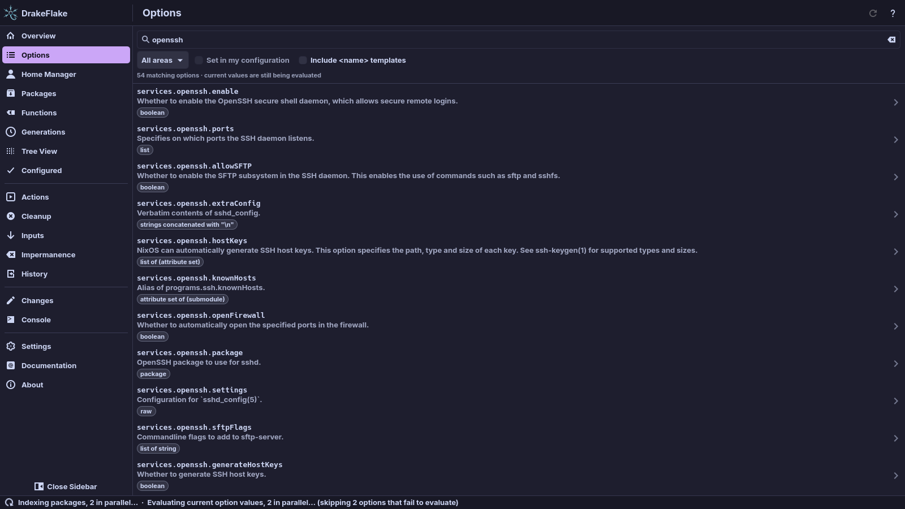
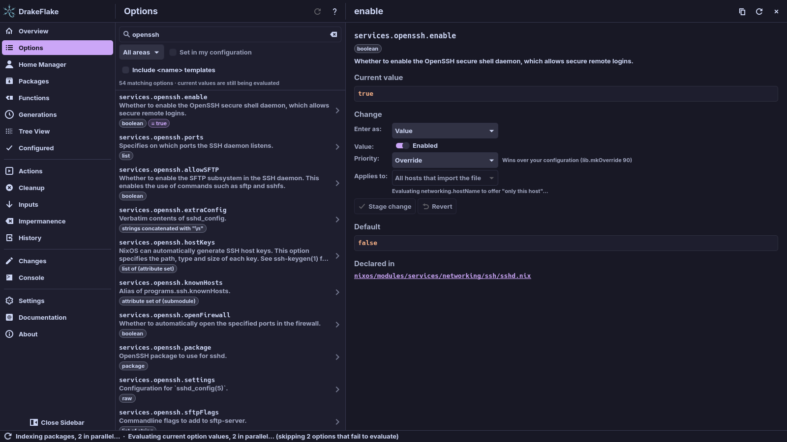
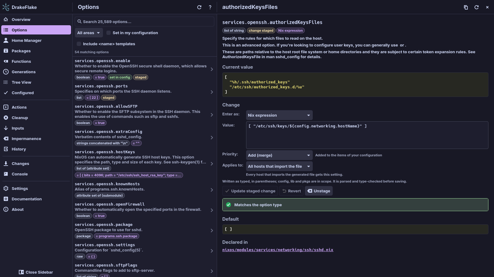
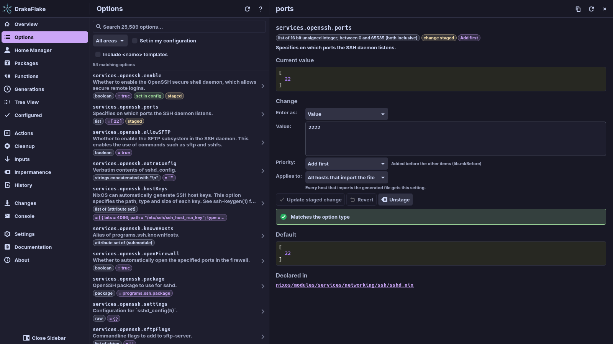
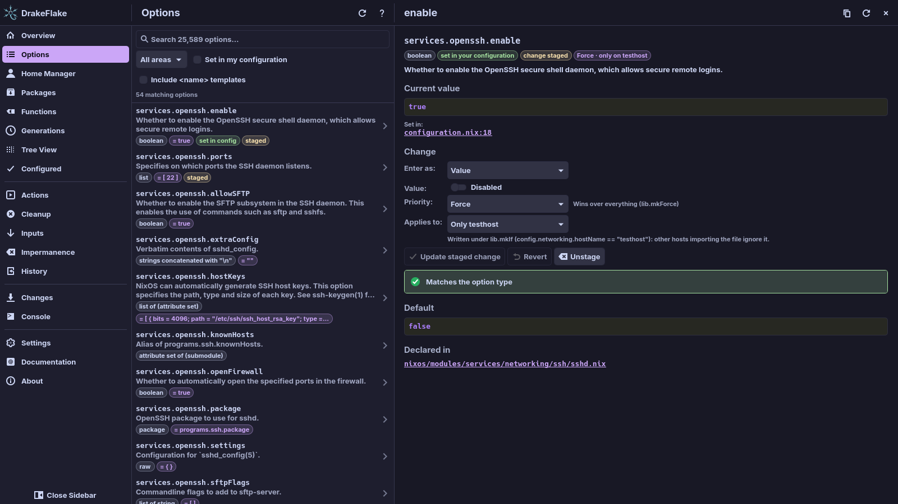
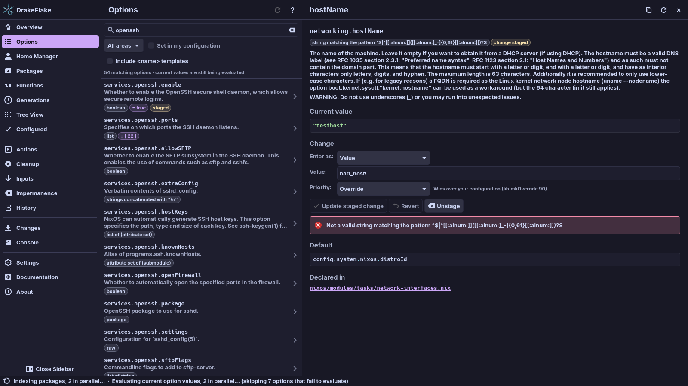
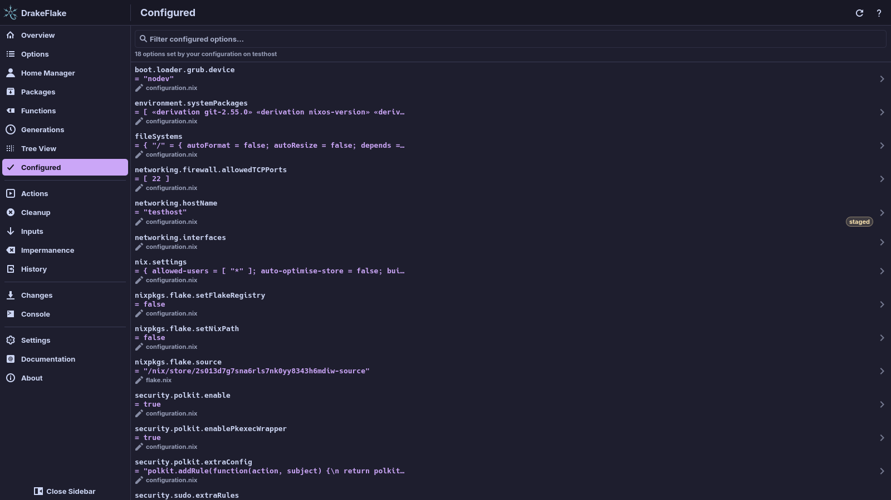

# Searching and changing options

Use the **Options** page to find any option of your host (NixOS or nix-darwin),
see its current value and stage a new one. This page also covers the
**Tree View** and **Configured** pages, which show the same options in other
ways.

## Before you start

- Select a system. Without one, the page shows **No system selected** and an
  **Open Settings** button. See [Settings](settings.md#system).
- The first time, the app builds an option index from your system flake. This
  can take a minute. Afterwards the index is cached and only rebuilt when your
  flake changes. While it builds, the page shows **Loading NixOS options…**.
- On a nix-darwin host, some NixOS features are left out. See
  [nix-darwin systems](darwin.md).

If the page shows **Could not load NixOS options**, see
[Troubleshooting](troubleshooting.md).

## Find an option

1. Open **Options**.
2. Type into the search field, for example `openssh`. Each word you type must
   appear in the option's name or description.
3. Read the results. The best matches come first. The line under the filters
   shows how many options match, for example "12 matching options".
4. If the list ends with **Show more (… left)**, click it to see more results.

While the app still evaluates the current values, the count line adds
"current values are still being evaluated". Values and the
**Set in my configuration** filter appear when that is done.

Each row shows the option name, the start of its description and these tags:

| Tag                            | Meaning                                          |
| ------------------------------ | ------------------------------------------------ |
| type, for example `boolean`    | The option's type                                |
| `= …`                          | Its current value, once values are evaluated     |
| **set in config**              | Your own configuration sets it                   |
| **managed**                    | The generated file sets it                       |
| **staged** or **staged reset** | You have a change for it that is not applied yet |
| **read-only**                  | It cannot be set                                 |

To re-evaluate options and values, click **Refresh** at the top.

### Filters

- **All areas**: limit the list to one area, such as `services` or `boot`.
  Type into **Filter areas…** to find an area. The number after each area
  counts its options.
- **Set in my configuration**: show only options your own files define. It
  becomes available once the current values are evaluated.
- **Include `<name>` templates**: also show options of named entries, such as
  `users.users.<name>.shell`. You cannot set these directly. Search for the
  concrete name instead (for example `users.users.alice.shell`) or set them in
  your own configuration.

For keys that work in the filter pickers, see
[Keyboard](introduction.md#keyboard).

If nothing matches, the page shows **No matching options**. Try fewer or
different words, or another area.

## Browse all options as a tree

The **Tree View** page shows every option, including defaults, as an expandable
tree.

- The tree is built the first time you open the page, in the background.
  Until it is ready the page says **Building the tree…**. After that it
  updates by itself when the options or their values change.
- All folders start open. Click a folder to collapse it in place.
- **Collapse all** and **Expand all** close or open every folder at once.
- Click an option to open its details.
- Each row shows the current value once it is evaluated, else the declared
  default. Until the values are ready, a banner says so. Options your own files
  define get a **set in config** tag.
- The search field lists the best matches across the whole tree.
- When your flake has Home Manager users, a dropdown switches between
  **System options** and **Home Manager options**.
- **Refresh** re-evaluates options and values.

## Read an option's details

Click an option to open its details next to the list. The example below shows
`services.openssh.enable`.

The page shows:

- the full name and type
- tags:
  - **set in your configuration**: your own files set it
  - **managed by DrakeFlake**: the generated file sets it
  - **change staged** or **removal staged**: a change waits on the **Changes**
    page. A second tag sums up its settings when they are not the defaults,
    for example "Force · only on laptop".
  - **read-only** or **template**: you cannot set it here
- the description
- **Current value**: the value your configuration evaluates to. It is evaluated
  when you open the option and shows **Evaluating your configuration…**
  meanwhile. If that fails, you see the error and a **Try again** button. If
  the value was not evaluated, click **Evaluate current value**.
- **Set in:**: the files of your configuration that set the option, with the
  line. Click one to open it in your editor (see
  [Where is this set?](#where-is-this-set)).
- **Default**, **Example** and **Declared in**: the option's documentation. For
  options from nixpkgs, **Declared in** links to the module on GitHub.

The buttons at the top:

- **Copy name** copies the option name.
- **Re-evaluate** evaluates the current value again.
- **Close** closes the page.

## Change an option

To change an option, fill in the **Change** section of its details page:

1. Choose how to enter the value under **Enter as:** (see
   [Enter as](#enter-as)).
2. Enter the value, for example switch `services.openssh.enable` to
   **Enabled**.
3. Optional: choose a **Priority:** (see [Priority](#priority)).
4. Optional: under **Applies to:**, limit the setting to this host (see
   [Applies to](#applies-to)).
5. Click **Stage change**.

When it worked, the details page shows the **change staged** tag, the option's
row shows **staged** and the **Changes** entry in the sidebar counts one more
change.

> **Note:** Staging writes nothing. Your system changes only when you apply the
> staged changes on the **Changes** page (see
> [Reviewing and applying](applying.md)). Until then, **Unstage** drops the
> change.

Options that are read-only or templates have no editor. The **Change** section
says **This option is read-only and cannot be set.** or explains which concrete
name to search for instead.

### Enter as

- **Value**: enter a plain value with an editor that fits the type:
  - a switch for booleans (**Enabled**/**Disabled**)
  - a number field for numbers
  - a list to choose from for enumerations
  - a text field for strings and paths
  - one item per line for lists

  For package options, type the package attribute, for example `firefox` or
  `kdePackages.kate`. Options that can be `null` have an **Unset (null)** box.

- **Nix expression**: type any Nix expression. `config`, `lib` and `pkgs` are in
  scope, so you can write for example `config.networking.hostName + "-vm"`. The
  expression is written as typed (in parentheses). It is parsed and type-checked
  before saving.

Options whose type has no simple editor (for example an attribute set such as
`{ foo = "bar"; }`) are always entered as a Nix expression. They are
syntax-checked before saving.

### Priority

NixOS merges the definitions of an option from all files of your configuration.
**Priority:** decides how the app's setting combines with yours. The choices
depend on the option.

| Priority        | What it does                                                    |
| --------------- | --------------------------------------------------------------- |
| **Override**    | Wins over your configuration (`lib.mkOverride 90`)              |
| **Default**     | Your configuration wins (`lib.mkDefault`)                       |
| **Normal**      | Same priority as your configuration. Different values conflict. |
| **Force**       | Wins over everything (`lib.mkForce`)                            |
| **Add (merge)** | Added to the items of your configuration                        |
| **Add first**   | Added before the other items (`lib.mkBefore`)                   |
| **Add last**    | Added after the other items (`lib.mkAfter`)                     |
| **Replace**     | Replaces what your configuration defines (`lib.mkForce`)        |

If you do not choose one, the app picks:

- **Add (merge)** for lists and attribute sets
- **Override** for single values
- **Override** for a value of `null`
- **Normal** for a single value of a type without a simple editor (for example
  "string or signed integer") entered as a plain value

The hint next to the field explains the chosen priority.

### Applies to

If several hosts import the same generated file, you can limit a setting to
this host:

- **All hosts that import the file**: every host that imports the generated
  file gets the setting.
- **Only this host (…)**: the setting is written under
  `lib.mkIf (config.networking.hostName == "…")`, so other hosts importing the
  file ignore it.

"Only this host" needs the evaluated `networking.hostName` of your system, so it
becomes available a moment after the page opens. It is not offered for
`networking.hostName` itself.

### Stage, revert or remove

| Button                                         | What it does                                                                                                    |
| ---------------------------------------------- | --------------------------------------------------------------------------------------------------------------- |
| **Stage change** (or **Update staged change**) | Puts the change into the list on the **Changes** page. Nothing is written yet.                                  |
| **Revert**                                     | Undoes your edits in the editor                                                                                 |
| **Unstage**                                    | Drops the staged change                                                                                         |
| **Remove from DrakeFlake file**                | For an option the generated file already sets: stages its removal. The rest of your configuration then decides. |

> **Note:** **Remove from DrakeFlake file** only stages the removal. The tag
> **removal staged** appears. Click **Unstage** to keep the setting.

### Type checks

Values are checked twice:

1. While you type, the value is checked against the option type. An invalid
   value shows the reason, and **Stage change** stays disabled.
2. After staging, the app checks the value against your configuration's option
   types in the background. The result appears under the buttons ("Matches the
   option type") and on the **Changes** page. You cannot apply changes while a
   staged value does not match its type.

If a staged value does not match, see
[Troubleshooting](troubleshooting.md).

## Where is this set?

Under **Current value**, **Set in:** lists the files that define the option,
with a line number. The app finds the line from the file's syntax tree. Nested
attribute sets, `config = …` and `lib.mkIf`/`lib.mkMerge` wrappers are
included. Files that come from a flake input instead of your own flake are
marked "(flake input, read-only)".

To open a file, click its location. It opens in your default text editor.

- These editors open the file at the line: Zed, VS Code and VSCodium. On Linux
  also Kate, KWrite, GNOME Text Editor and Emacs. On a Mac also Sublime Text.
- On a Mac, the default editor is the app set for plain text files. To change
  it, select a `.txt` file in Finder and use Get Info → Open with → Change All….

## See everything your host sets

The **Configured** page lists every option your host's own configuration files
define, with its current value and the file it is set in. A count line says how
many options your configuration sets on this host.

- Type into **Filter configured options…** to narrow the list.
- Click an option to open its details.
- Tags show **managed** for options the generated file sets and **staged** for
  options with a pending change.
- **Refresh** re-evaluates options and values.

The first run can take several minutes and shows
**Evaluating your configuration…** meanwhile. Afterwards the result is cached.
If it shows **Could not evaluate your configuration**, see
[Troubleshooting](troubleshooting.md).

## Related

- [Reviewing and applying](applying.md)
- [Home Manager](home-manager.md)
- [Nix functions](functions.md)
- [Troubleshooting](troubleshooting.md)
