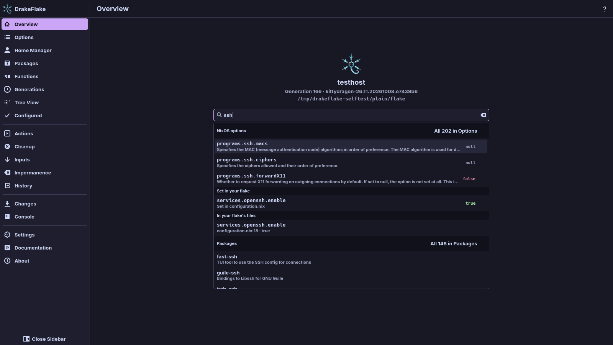

# Overview and search

The app opens on the **Overview**. From here you can see which system you
manage, search everything the app knows and jump to the main sections.

The top of the page shows:

- the host (or **No system chosen** before you pick one in the
  [setup assistant](setup.md)),
- the running generation with its NixOS or nix-darwin version,
- the folder of your system flake.

## Search everything

The search field has the focus when the Overview opens, so you can start typing
right away.

1. Type into the search field, for example `ssh` or `firefox`.
2. A list opens below the field as soon as something matches. It is grouped by
   where the hits come from. Each group shows its three best hits.
3. Open a hit with the mouse or the keyboard (see
   [Open a hit](#open-a-hit)).

If nothing matches, the list says **Nothing found for “…”.**

### What the search finds

| Group                                               | What it finds                                                                                                                                                                                                                                              |
| --------------------------------------------------- | ---------------------------------------------------------------------------------------------------------------------------------------------------------------------------------------------------------------------------------------------------------- |
| **Pages**, **Actions**, **Settings**                | The sections of the app, things to do (such as **Rebuild and switch** or **Update all inputs**) and the fields of the Settings page. Other words work too, for example "rollback" finds Generations.                                                       |
| **NixOS options** (**nix-darwin options** on a Mac) | The same search as on the Options page, with the current value or the default.                                                                                                                                                                             |
| **Set in your flake**                               | Options your own files set, with the file.                                                                                                                                                                                                                 |
| **In your flake's files**                           | Attributes, strings and references such as `pkgs.firefox` in your flake's `.nix` files, with file and line. Nested sets are found by their full path (`services.openssh.enable`). Comments are not searched. This group appears a moment after the others. |
| **Home Manager · user**                             | The options of the user chosen on the Home Manager page. Only when the host uses Home Manager, once its options are loaded.                                                                                                                                |
| **Packages**                                        | The same search as on the Packages page.                                                                                                                                                                                                                   |
| **Functions**                                       | Nix functions from the [Functions](functions.md) page, with their type.                                                                                                                                                                                    |
| **Programs**                                        | Packages that provide a program of that name. This group appears a moment after the other hits.                                                                                                                                                            |
| **Inputs**, **Generations**, **History**            | Flake inputs by name or source, generations by number, date, NixOS version or kernel, and earlier applies by date or what they changed.                                                                                                                    |

> **Note:** The **Programs** group needs the nix-index database and
> `nix-locate` on your `PATH` (see
> [Search by command](packages.md#search-by-command)). The Overview never
> downloads or builds them.

Option values that are `true` or `false` are shown in colour, so you see at a
glance what is on. The value is always written out as well.

To see more than the three best hits, click the link at the end of a group:
**All … in Options** (or **All … in Packages**, **All … in Functions**,
**All … in Configured**, **All … in Home Manager**). It opens that section with
the same search.

### Open a hit

| Key              | What it does               |
| ---------------- | -------------------------- |
| <kbd>↓</kbd>     | Highlight the next hit     |
| <kbd>↑</kbd>     | Highlight the previous hit |
| <kbd>Enter</kbd> | Open the highlighted hit   |
| <kbd>Esc</kbd>   | Close the list             |

Clicking a hit opens it too. What happens depends on the hit:

- An option, package or function opens its details next to the list.
- An input, generation or history entry opens its section.
- A hit in **In your flake's files** opens the file in your editor.
- The other actions open the page that does it. For example **Check inputs for
  updates** opens Inputs, and **Setup assistant** opens the setup assistant.

> **Warning:** A rebuild (**Rebuild and switch** and the like) or
> **Update all inputs** runs right away, like its button elsewhere. A rebuild
> changes your running system. **Update all inputs** rewrites `flake.lock`. The
> output shows in the **Console**. To go back after a rebuild, see
> [Generations, cleanup and actions](maintenance.md).

## Go to a section

Below the search, a tile for each main section says what is there now. Click a
tile to open its section.

| Tile             | What it shows                                                                                                    |
| ---------------- | ---------------------------------------------------------------------------------------------------------------- |
| **Options**      | The number of options                                                                                            |
| **Home Manager** | The Home Manager user, or **Not set up on this host**                                                            |
| **Packages**     | The number of installed packages                                                                                 |
| **Functions**    | The number of Nix functions                                                                                      |
| **Generations**  | The running generation. Hidden for a host of another kind than this machine (for example a NixOS host on a Mac). |
| **Inputs**       | The number of inputs, or how many updates are available once they were checked on the [Inputs](inputs.md) page   |
| **Changes**      | The number of staged changes, or **Nothing staged**                                                              |
| **Actions**      | **Images, VM, recommendations**, or **Recommendations** where images are not available                           |
| **Cleanup**      | **Free disk space**                                                                                              |

While options and packages are still loading, their tiles show a spinner. The
**Inputs** and **Changes** tiles are highlighted when updates are available or
changes are staged.

## Related

- [Searching and changing options](options.md)
- [Packages](packages.md)
- [Reviewing and applying](applying.md)
- [Flake inputs](inputs.md)
