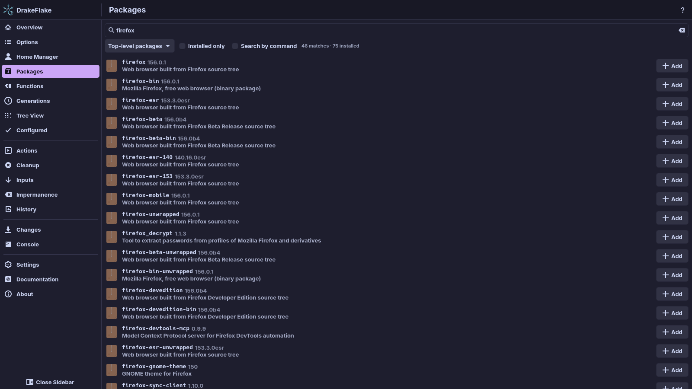
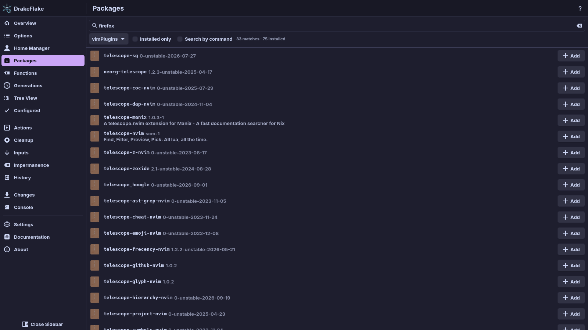
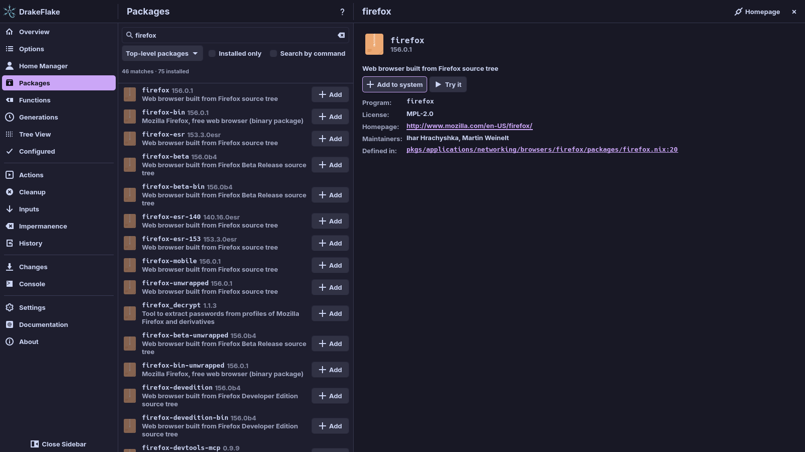

# Packages

Use the **Packages** page to find, add, remove and try packages. It searches the
nixpkgs your system uses, so what you find is exactly what your system would
install.

## Before you start

- Select a system in **Settings** (see [Settings](settings.md#system)).
- The first search builds an index. This takes a few seconds the first time.
  The page shows **Indexing packages…** meanwhile.

If the page shows **Could not index packages**, see
[Troubleshooting](troubleshooting.md).

## Find a package

1. Open **Packages**.
2. Type a name or a word from the description into the search field, for
   example `firefox` or `password manager`.
3. Read the results. The line next to the filters shows the number of matches
   and of installed packages, for example "12 matches · 1 installed".
4. If the list ends with **Show more (… left)**, click it to see more results.

Each row shows the package name, its version and description, and these tags:

| Tag                                     | Meaning                        |
| --------------------------------------- | ------------------------------ |
| **installed**                           | Your system already has it     |
| **added by DrakeFlake**                 | The generated file installs it |
| **will be added** / **will be removed** | A staged change                |

If nothing matches, the page shows **No matching packages**. Try another name
or a word from the description.

### Filters

- **Top-level packages**: choose a package set instead, such as
  `python313Packages`, `haskellPackages` or `vimPlugins`. Type into
  **Filter package sets…** to find a set. A set is indexed the first time you
  choose it and kept until your flake changes.
- **Installed only**: show only packages your system has.
- **Search by command**: find the package that provides a program, for example
  `rg` finds `ripgrep`. See [Search by command](#search-by-command).

### Search by command

Use this when you know a program's name but not its package.

1. Check **Search by command**.
2. Type the program name, for example `rg`. Programs are matched by their exact
   name in `bin/`.
3. Read the result. It lists the packages that provide the program, or says
   **No package has a program named …**.

This search uses the nix-index database. If you do not have one in
`~/.cache/nix-index`, the page offers to **Download** it:

- It is a prebuilt database from the nix-community/nix-index-database project
  on GitHub.
- It is about 100 MB and updated weekly.
- The app downloads the database for the machine it runs on (Linux or macOS,
  and its CPU architecture).
- The app keeps its copy in `~/.cache/drakeflake/nix-index`.

The page shows **Downloading the command index…** while it downloads.

## Add a package

1. Click **Add** in the package's row, or **Add to system** on its details
   page.
2. Check the row. It now shows **will be added** and an **Undo** button.
3. Apply the change on the **Changes** page (see
   [Reviewing and applying](applying.md)).

> **Note:** Adding only stages the change. Nothing is installed until you apply
> it. Click **Undo** to take it back before that.

## Remove a package

1. Click **Remove** in the package's row, or **Remove from system** on its
   details page.
2. Check the row. It now shows **will be removed** and an **Undo** button.
3. Apply the change on the **Changes** page.

The app only removes packages it added itself. Packages installed by your own
configuration show **From your config** in the list and
**Installed by your configuration** on the details page. Remove those in your
own files.

To take back a staged addition or removal, click **Undo**.

### Where added packages go

Added packages are written as `environment.systemPackages` into the generated
file:

- with a split layout, into `packages.nix`
- with a custom layout rule for `environment.systemPackages`, into the file of
  that rule

The layout is chosen in the setup assistant (see
[First start: the setup assistant](setup.md)).

### Packages from a package set

Packages from a package set are mostly libraries. They usually belong in an
environment, for example `python3.withPackages`, rather than directly in the
system packages. The details page reminds you of this.

## Read a package's details

Click a package to see its details. The **About** section shows:

| Field            | What it shows                       |
| ---------------- | ----------------------------------- |
| description      | What the package is                 |
| **Program:**     | The program it runs                 |
| **License:**     | Its license                         |
| **Homepage:**    | The project's website               |
| **Maintainers:** | The nixpkgs maintainers             |
| **Outputs:**     | The package's outputs               |
| **Defined in:**  | The file in nixpkgs that defines it |

Tags show whether it is **unfree** or **marked broken**. **Homepage** at the top
opens the project's website. **Close** closes the details.

## Try a package without installing it

**Try it** runs a package without installing it. It is offered for packages
that declare a program to run.

1. Open the package's details.
2. Click **Try it**. The app builds the package from your system's nixpkgs. A
   message on the details page says so, and the progress shows in the
   **Console**.
3. Wait. The package starts by itself when it is ready:
   - An app with a desktop entry opens as a window.
   - A command-line tool opens in a terminal with the package's programs
     available.

Your system does not change. Tried packages are kept so they start quickly next
time. To free their space, use **Remove tried packages (…)** on the **Cleanup**
page (see [Generations, cleanup and actions](maintenance.md#cleanup)).

If the package does not start, check the **Console** for the error (see
[Reviewing and applying](applying.md#the-console)).

## Related

- [Reviewing and applying](applying.md)
- [Searching and changing options](options.md)
- [Generations, cleanup and actions](maintenance.md)
- [Troubleshooting](troubleshooting.md)
