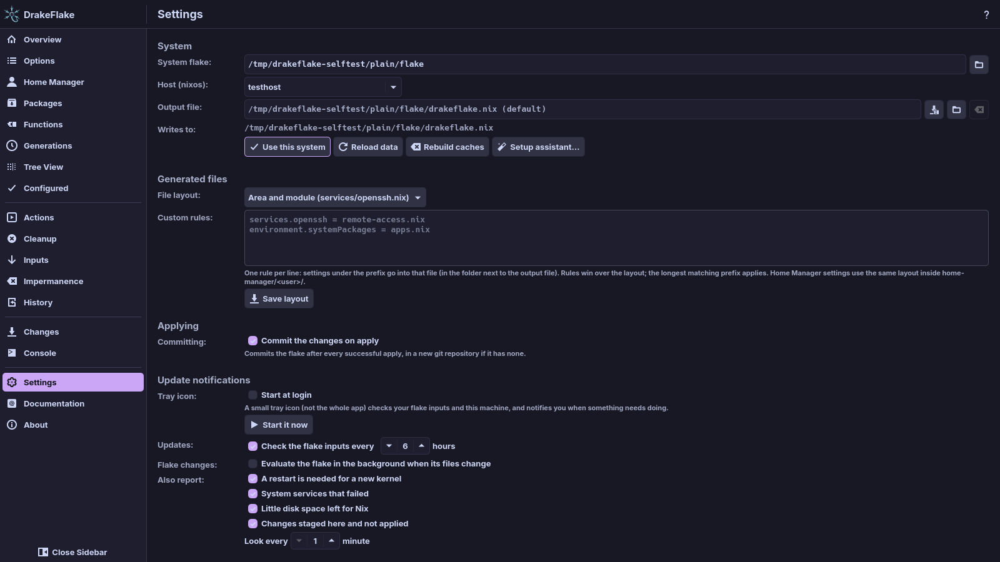

# Settings

The Settings page holds the system the app manages, how it splits its
generated files, committing, the tray, highlighting, appearance and logging.
Each section below matches a section of the page.

## Before you start

The app only changes its generated files. The rest of your configuration is
never edited. Import the entry file once from your host configuration, so the
flake uses the generated files:

```nix
imports = [ ./drakeflake.nix ];
```

The [setup assistant](setup.md#3-import) shows the line for your flake and
checks the import.



## System

- **System flake:** the folder that holds your `flake.nix`, for example
  `/etc/nixos` or `~/nixos-config`. When empty, the field shows the default
  folder. **Browse…** opens a folder chooser.
- **Host:** the configuration of this machine (`nixosConfigurations.<host>` or
  `darwinConfigurations.<host>`). Choose it from the list or type its name.
  Once the host is loaded, the label shows its kind, "Host (nixos):" or
  "Host (darwin):".
- **Output file:** where the app writes its generated entry file. Leave it empty
  for the default, `drakeflake.nix` next to `flake.nix`. The empty field shows
  that default, for example `/etc/nixos/drakeflake.nix (default)`.
  - **Choose file…**: pick a `.nix` file.
  - **Choose folder…**: pick a folder, for example `/etc/nixos/modules`. With a
    split layout the app writes `default.nix` there, so you import the folder.
    With a single file it writes `drakeflake.nix` there.
  - **Use default**: clear the field, so the app writes `drakeflake.nix` next
    to `flake.nix`.

  The file must be inside the flake, because a flake can only import files
  from its own folder. **Writes to:** shows the file that will actually be
  written. These buttons only fill the field. Nothing changes until you click
  **Use this system**.

- **Use this system**: switch to the flake, host and output file entered above.
  Staged changes are kept per system, so switching does not lose them.
- **Reload data**: read options, values and packages again. Cached data is
  reused when your flake has not changed.
- **Rebuild caches**: forget the cached option, value and package indexes and
  the list of hosts, and evaluate everything again.
- **Setup assistant…**: open the [setup assistant](setup.md).

### Switch to another flake or host

1. Pick the folder with **Browse…** next to **System flake:**.
2. Choose the host from the list next to **Host:**.
3. Optionally set **Output file:**.
4. Click **Use this system**, or press Enter in one of the two text fields (see
   [Keyboard](introduction.md#keyboard)). The button stays disabled while the
   flake field is empty.

The app then loads the new system. The status bar shows what it is doing, for
example "Reading hosts from the flake…". When loading fails, an error message
appears at the top of the System section. See
[Troubleshooting](troubleshooting.md).

> **Note:** Changing the output file does not move or delete the files the app
> wrote before. If your configuration does not import the new file yet, the
> Console warns "Your configuration does not import … yet". Change your import
> as it says, or applied changes have no effect. At the next save the app
> removes the other entry file in the same folder (`drakeflake.nix` or
> `default.nix`).

### Reload or rebuild the data

- Click **Reload data** after you changed your flake outside the app. The
  status bar shows the loading steps. The pages show the new values when it is
  done.
- Click **Rebuild caches** when the app shows outdated options or packages even
  after **Reload data**. The status bar shows steps such as "Building the
  option index…".

> **Note:** **Rebuild caches** deletes the cache folder of this flake and host
> under `~/.cache/drakeflake/` (or `$XDG_CACHE_HOME/drakeflake/`). Your flake
> is not touched. The next load evaluates everything
> again, which takes longer than a load from the cache.

## Generated files

**File layout:** decides how the settings are split over files:

- **Area and module (services/openssh.nix)**: one file per area and module.
  Options with a short name, such as `networking.hostName`, go into the area's
  file (`networking.nix`).
- **By area (services.nix)**: one file per top-level area.
- **Single file**: everything in the entry file.

With a split layout, the entry file only imports the other files. They live in
a folder next to it:

- `drakeflake/` for `drakeflake.nix`
- the same folder when the entry file is a folder's `default.nix`

Packages go into `packages.nix`. Home Manager settings use the same layout
inside `home-manager/<user>/`.

**Custom rules:** one rule per line, in the form `prefix = file.nix`. Settings
whose option name starts with the prefix go into that file, in the folder next
to the output file.

- Rules win over the layout.
- When several rules match, the one with the longest prefix applies.
- Use `environment.systemPackages` as the prefix to move the package list.
- A `#` starts a comment, also after a rule.
- File names may use letters, digits, `.`, `_`, `-` and `/`. `.nix` is added
  when missing.

For example:

```text
services.openssh = remote-access.nix
environment.systemPackages = apps.nix
```

### Change the layout

1. Pick a **File layout:** and edit the **Custom rules:**.
2. Click **Save layout**. The new layout takes effect with the next save.
   **Writes to:** updates to the new entry file.

If a rule is wrong, a red message below the rules names the line, for example
"line 2: expected `prefix = file.nix`". Nothing is saved until you fix it.

> **Note:** If the change renames the entry file (`drakeflake.nix` and
> `default.nix` in an output folder), the next save removes the old generated
> entry file and its parts. The Console then says "Change your import to …".
> Until you change the import, your flake does not load the generated files.

## Applying

**Committing:** **Commit the changes on apply** (on by default) commits the
flake after every successful apply. When the flake has no git repository yet,
the app creates a new one. See
[Automatic commits](applying.md#automatic-commits).

## Update notifications

- **Tray icon:** (on a Mac **Menu bar icon:**): turn on **Start at login** to
  start `drakeflake-tray` (on a Mac `drakeflake-tray-macos`) with your session.
  **Start it now** starts it right away. With **Start at login** on, opening
  DrakeFlake also starts the tray when it is not running.
- **Updates:** **Check the flake inputs every … hours** turns the update check
  on or off and sets its interval (1 to 168 hours, default 6).
- **Also report:** which local findings the tray shows:
  - **A restart is needed for a new kernel**
  - **System services that failed**
  - **Little disk space left for Nix**
  - **Changes staged here and not applied**

  **Look every … minutes** sets how often it looks (1 to 60, default 1).

- **Flake changes:** **Evaluate the flake in the background when its files
  change** lets the tray re-read the options and values after your flake
  changes. It is off by default. See
  [Evaluating when the flake changes](inputs.md#evaluating-when-the-flake-changes).

The tray is a small icon, not the whole app. It checks your flake inputs and
this machine, and notifies you when something needs doing. On a Mac the kernel
and failed-service boxes are shown but report nothing, because macOS has no
equivalent (see [nix-darwin systems](darwin.md)).

When **Start it now** works, the icon appears in the panel or menu bar. If it
already runs, the Console says "The tray icon is already running." If it cannot
start, the Console says "Could not start the tray: …".

> **Note:** **Start at login** writes a file that starts the tray with your
> session. Turning the box off deletes that file again.
>
> - Linux: `~/.config/autostart/drakeflake-tray.desktop` (or under
>   `$XDG_CONFIG_HOME/autostart/`)
> - macOS: the LaunchAgent
>   `~/Library/LaunchAgents/org.dr460nf1r3.drakeflake.tray.plist`

See [Update notifications in the tray](inputs.md#update-notifications-in-the-tray).

## Code highlighting

**Theme:** the syntax highlighting theme for Nix code in previews, values and
the Console. The "Automatic" entry follows your desktop:

- Under Plasma it picks the highlighting theme whose name matches your colour
  scheme or global theme (for example Catppuccin Mocha).
- Otherwise it picks Breeze Light or Breeze Dark by the brightness of your
  colours.

**Preview:** shows the chosen theme.

## Appearance

**Blurred background:** whether the compositor blurs the desktop behind the
window. On a Mac the blur always follows the system, so this section is hidden
there.

The app asks for the blur through the Wayland protocol
`ext-background-effect-v1`. Compositors that offer it include KWin 6.7, GNOME
51 and niri 26.04. X11 has no common blur protocol, so on X11 the window always
stays solid.

- **Automatic (blur on Wayland)**: asks the compositor quietly. The background
  blurs where the compositor offers the effect, and stays solid elsewhere.
- **On**: always asks the compositor for the blur, and warns when it does not
  offer the effect. The window then stays solid.
- **Off**: never blur.

On a Mac the system blur is always available, so **Automatic** and **On** both
blur. **Off** takes effect the next time the app starts.

The blurred window keeps most of the theme colour (70%), so text stays readable
over a busy desktop. The choice takes effect at once. A line below the choices
says whether the window blurs. When the `DRAKEFLAKE_BLUR` variable is set, that
line says the variable overrides your choice (see
[Environment variables](#environment-variables)).

## Troubleshooting

- **Log detail:** how much the app writes to its log file: **Errors only**,
  **Warnings**, **Normal (recommended)**, **Debug: every command run** or
  **Trace: also full command output**. A new level takes effect at once. Debug
  messages from the interface itself are added after a restart.
- **Open log** opens the log file. The Console says "Opened … at line …".
- **Show folder** opens the folder that holds it. The Console only shows a
  message when the folder cannot be opened.

The section names the log file. It is
`~/.local/state/drakeflake/drakeflake.log` (or under `$XDG_STATE_HOME`), on
Linux and on a Mac. Older logs are kept as `.1` to `.3`. See
[Troubleshooting](troubleshooting.md#the-log-file) for what to look for.

## The configuration file

The settings are stored in `~/.config/drakeflake/config.toml`, or under
`$XDG_CONFIG_HOME` when it is set. The app writes it for you, so you normally
do not need to edit it. Missing keys take their defaults.

```toml
[general]
highlight_theme = ""       # empty: automatic
log_level = "info"         # error, warn, info, debug or trace
blur = "auto"              # auto, on or off: the blur behind the window (Wayland)
auto_commit = true         # commit the flake after every successful apply

[nix]
flake_path = "/etc/nixos"  # the system flake (default /etc/nix-darwin on a Mac)
host = "laptop"            # the host, omit to choose it automatically
managed_path = "/etc/nixos/modules/"  # output file or folder, omit for default

[layout]
mode = "area-module"       # single, area or area-module

[[layout.rules]]
prefix = "services.openssh"
file = "remote-access.nix"

[tray]
updates = true             # check the flake inputs on a schedule
check_hours = 6            # 1 to 168
health_minutes = 1         # 1 to 60
restart = true             # report: a restart is needed for a new kernel
failed_services = true     # report: failed system services
low_space = true           # report: little space left for Nix
staged = true              # report: changes staged and not applied
watch_flake = false        # evaluate the flake when its files change
```

| Key                       | Meaning                                                                                                                      |
| ------------------------- | ---------------------------------------------------------------------------------------------------------------------------- |
| `general.highlight_theme` | Name of the highlighting theme. Empty means automatic.                                                                       |
| `general.log_level`       | Detail of the log file: `error`, `warn`, `info` (default), `debug` or `trace`. Also used by the tray.                        |
| `general.blur`            | Blurred window background on Linux: `auto` (default, blur on Wayland), `on` or `off`. Ignored on a Mac.                      |
| `general.auto_commit`     | Commit the flake after every successful apply (default `true`).                                                              |
| `nix.flake_path`          | The system flake. Default `/etc/nixos`, on a Mac `/etc/nix-darwin`.                                                          |
| `nix.host`                | The host to manage.                                                                                                          |
| `nix.managed_path`        | The output `.nix` file, or a folder (an existing one, or a path ending in `/`). Unset: `drakeflake.nix` next to `flake.nix`. |
| `layout.mode`             | `single`, `area` or `area-module` (default).                                                                                 |
| `layout.rules`            | Custom rules, each with `prefix` and `file`.                                                                                 |
| `tray.*`                  | What the tray checks and how often, see above and [the tray](inputs.md#update-notifications-in-the-tray).                    |

### Environment variables

For testing and special setups, these variables override the saved settings
when the app starts:

| Variable                          | Effect                                                                                  |
| --------------------------------- | --------------------------------------------------------------------------------------- |
| `DRAKEFLAKE_FLAKE`                | Use this flake instead of the saved one.                                                |
| `DRAKEFLAKE_HOST`                 | Use this host.                                                                          |
| `DRAKEFLAKE_MANAGED_FILE`         | Use this output file or folder.                                                         |
| `DRAKEFLAKE_SETUP=1`              | Open the setup assistant on start.                                                      |
| `DRAKEFLAKE_BLUR`                 | Blur behind the window for one run: `auto`, `on` or `off` (overrides the saved choice). |
| `DRAKEFLAKE_SOFTWARE_RENDERING=1` | Draw the window with the software renderer.                                             |
| `DRAKEFLAKE_EVAL_JOBS`            | How many evaluations run at once (normally chosen by CPU count and free memory).        |
| `DRAKEFLAKE_FUNCTION_INDEX`       | Read the index of the Nix functions page from this file instead of the package's.       |

### For packagers and developers

These variables point the app at its own parts. The package sets what it needs
itself, so you normally leave them unset.

| Variable                  | Effect                                                                                                                                                                                        |
| ------------------------- | --------------------------------------------------------------------------------------------------------------------------------------------------------------------------------------------- |
| `DRAKEFLAKE_HELPER`       | Absolute path of the root helper. Unset: `../libexec/drakeflake-helper` next to the app, or `drakeflake-helper` in the same folder. A path that is not an absolute path to a file is ignored. |
| `DRAKEFLAKE_ELEVATE`      | macOS only: the program the app runs every root command through. It shows the administrator dialog. Unset: `drakeflake-elevate` next to the app.                                              |
| `DRAKEFLAKE_ICON_DIR`     | Folder the tray takes its icons from. Unset: the package's `share/icons` (Linux) or `share/drakeflake/tray` (macOS).                                                                          |
| `DRAKEFLAKE_QML_DIR`      | Folder with the app's QML files (`Main.qml`). The package's wrapper sets it to its `share/drakeflake/qml`. Unset: the source tree, for development builds.                                    |
| `DRAKEFLAKE_DOCS_DIR`     | Folder with the user guide's Markdown pages. The package's wrapper sets it to its `share/drakeflake/docs`. Unset: `docs/src` of the source tree, for development builds.                      |
| `DRAKEFLAKE_ICON_RCC_DIR` | macOS only: folder with the icon theme bundles `breeze.rcc` and `breeze-dark.rcc`. The package's wrapper sets it. Unset: the folder baked in at build time, if any.                           |

> **Warning:** `DRAKEFLAKE_HELPER` chooses which program runs as root once you
> enter your password. `DRAKEFLAKE_ELEVATE` chooses the program that receives
> every command meant for root on a Mac. Only set them to programs you trust.
> With `pkexec` a helper at another path does not match the app's polkit
> actions, so the password prompt is the generic one instead of the app's own
> (see [Privacy and security](security.md)).

## Related

- [First start: the setup assistant](setup.md)
- [Reviewing and applying](applying.md)
- [Troubleshooting](troubleshooting.md)
