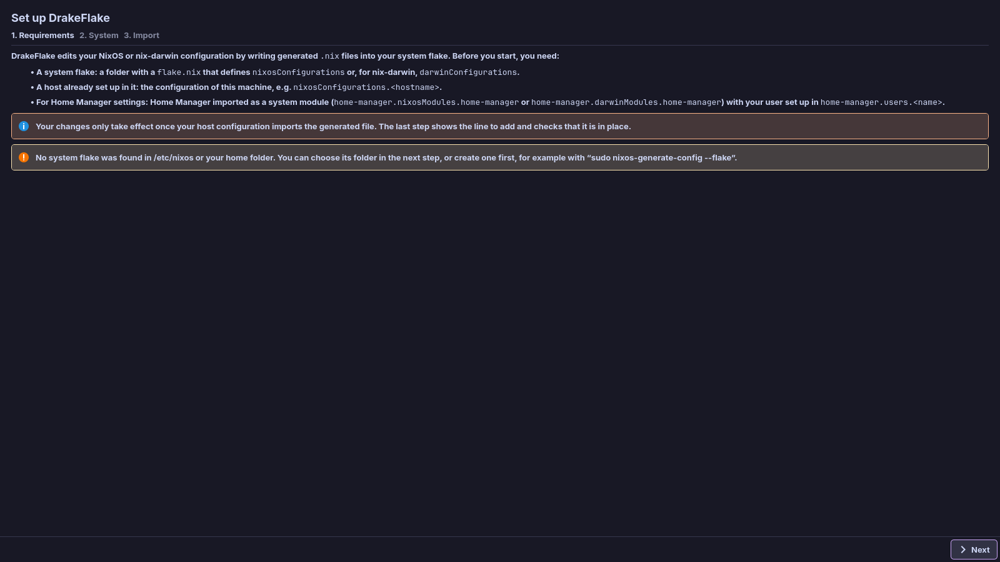
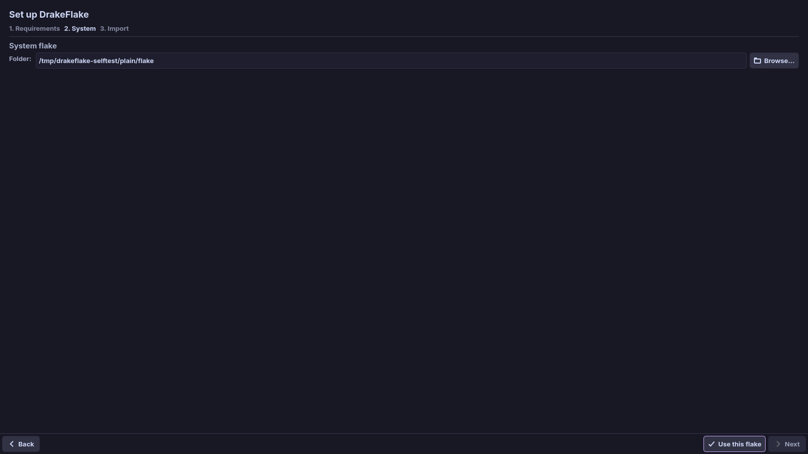
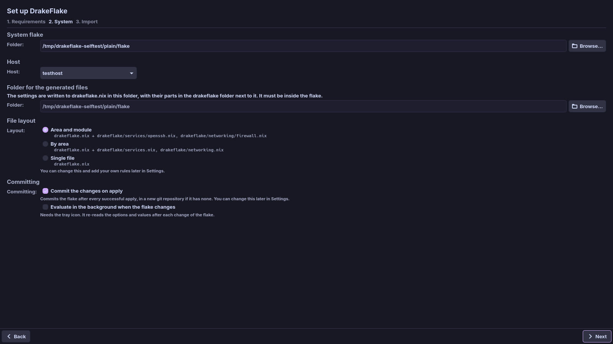
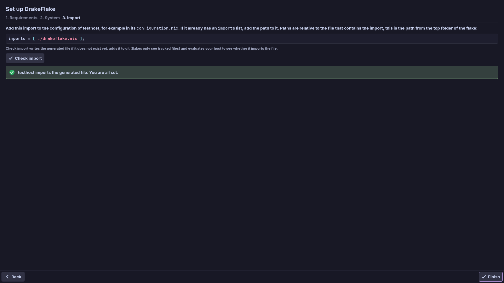

# First start: the setup assistant

The setup assistant (**Set up DrakeFlake**) helps you pick your system flake and
host and connect the generated file to your configuration. It has three steps:
**Requirements**, **System** and **Import**. Use **Back** to return to an
earlier step.

The assistant opens on the first start when there are no saved settings yet and
there is no flake in `/etc/nixos` (on a Mac `/etc/nix-darwin`). To open it again
at any time:

- click **Settings → Setup assistant…**, or
- type "setup" into the search on the [Overview](overview.md) and choose
  **Setup assistant**.

## 1. Requirements

The first step lists what the app needs:

- **A system flake**: a folder with a `flake.nix` that defines
  `nixosConfigurations` or, for nix-darwin, `darwinConfigurations`.
- **A host already set up in it**: the configuration of this machine, for
  example `nixosConfigurations.<hostname>`.
- **For Home Manager settings**: Home Manager imported as a system module
  (`home-manager.nixosModules.home-manager` on NixOS,
  `home-manager.darwinModules.home-manager` on nix-darwin) with your user set up
  in `home-manager.users.<name>`. See [Home Manager](home-manager.md).



While you read, the app looks for system flakes in these places (the message
**Looking for system flakes…** shows while it searches):

- `/etc/nixos` and `/etc/nix-darwin` (this machine's kind first),
- the usual places in your home folder and a few folder levels below it.

If it finds none, it says so. You can still choose the folder in the next step,
or create a flake first:

- on NixOS: `sudo nixos-generate-config --flake`,
- on a Mac: `nix flake init -t nix-darwin`.

Click **Next**.

## 2. System

In this step you choose the flake, the host, where the generated files go and
how they are split. **Next** stays disabled until the hosts of the flake are
read and the folder for the generated files exists inside the flake.

### Choose the system flake

1. Pick a flake listed under **Found:**, type a path into **Folder:**, or click
   **Browse…** to choose the folder.
2. Click **Use this flake**. The app shows **Reading the hosts of the flake…**
   while it evaluates the flake, which can take a moment.

If the folder holds no `flake.nix`, and no folder above it does either, the
assistant warns **There is no flake.nix in this folder or above it.**



### Choose the host

Choose the configuration of this machine under **Host:**. When a host's name
matches this computer's host name, it is preselected.

### Choose where the generated files go

This is where the app writes its files. It must be inside the flake, because a
flake can only import files from its own folder.

| Folder field                            | Single-file layout                   | Split layout                                                                            |
| --------------------------------------- | ------------------------------------ | --------------------------------------------------------------------------------------- |
| Empty (the top folder of the flake)     | `drakeflake.nix` next to `flake.nix` | `drakeflake.nix` next to `flake.nix`, its parts in a `drakeflake/` folder next to it    |
| Another folder (type it or **Browse…**) | `drakeflake.nix` in that folder      | `default.nix` in that folder with its parts next to it, so you import the folder itself |

Choose another folder, for example `modules/drakeflake`, to keep the generated
files apart. The text below the field says which file the settings go into.

- If the folder does not exist yet, the assistant shows **This folder does not
  exist yet.** Click **Create folder**.
- If the folder is outside the flake, it shows **The folder must be inside the
  flake (…).** Choose a folder inside the flake folder it names.

### Choose the file layout

Choose under **Layout:** how the settings are split over files:

- **Area and module**: one file per area and module, for example
  `services/openssh.nix` and `networking/firewall.nix`.
- **By area**: one file per area, for example `services.nix` and
  `networking.nix`.
- **Single file**: everything in one file.

With the split layouts, packages you add go into `packages.nix`. You can change
the layout and add your own rules later in
[Settings](settings.md#generated-files).

### Decide on automatic commits

**Commit the changes on apply** is preselected.

> **Note:** With this option on, the app commits the flake after every
> successful apply. If the flake has no git repository yet, the app creates one.
> You can turn this off later in Settings. See
> [Automatic commits](applying.md#automatic-commits).

### Decide on background evaluation

**Evaluate in the background when the flake changes** is off by default. Turn
it on to have the tray icon (on a Mac, the menu bar icon) re-read your options
and values after each change of the flake. The tray must run for this to
happen. See
[Evaluating when the flake changes](inputs.md#evaluating-when-the-flake-changes).



Click **Next**.

## 3. Import

Your changes only take effect once your host configuration imports the
generated file. This step shows the line to add, for example:

```nix
imports = [ ./drakeflake.nix ];
```

1. Add the line to the configuration of your host, for example in its
   `configuration.nix`. If the file already has an `imports` list, add the path
   to that list.
2. Check the path. The path shown starts at the top folder of the flake. Nix
   resolves import paths relative to the file that contains the import. So if
   that file lives in a subfolder, adjust the path. For example, in
   `hosts/myhost/configuration.nix` the line becomes
   `imports = [ ../../drakeflake.nix ];`.
3. Save the file.
4. Click **Check import**. The app shows **Evaluating …** while it checks.

The check:

1. writes the generated file if it does not exist yet,
2. adds it to git, because flakes only see tracked files,
3. evaluates your host to see whether it really imports the file.

> **Note:** The check never replaces a file that DrakeFlake did not generate. If
> a hand-written file already sits at that path, the check stops and leaves it
> untouched. Move or rename that file, or choose another folder.



What you see next:

| Result                                           | What to do                                                             |
| ------------------------------------------------ | ---------------------------------------------------------------------- |
| "… imports the generated file. You are all set." | Click **Finish**. The assistant closes and the app opens the Overview. |
| "… does not import the generated file yet. …"    | Add the line, save the file and click **Check import** again.          |
| "The check failed: …"                            | Read the message, fix the cause and click **Check import** again.      |

**Finish** is only enabled after a successful check. If the check keeps
failing, see [Troubleshooting](troubleshooting.md).

### Finish later

You can also click **Finish later** and add the import afterwards. Until then:

- the **Changes** page warns that your configuration does not import the file,
- applying refuses to rebuild. **Save only** still works.

## Related

- [Overview and search](overview.md)
- [Reviewing and applying](applying.md)
- [Settings](settings.md)
- [Troubleshooting](troubleshooting.md)
