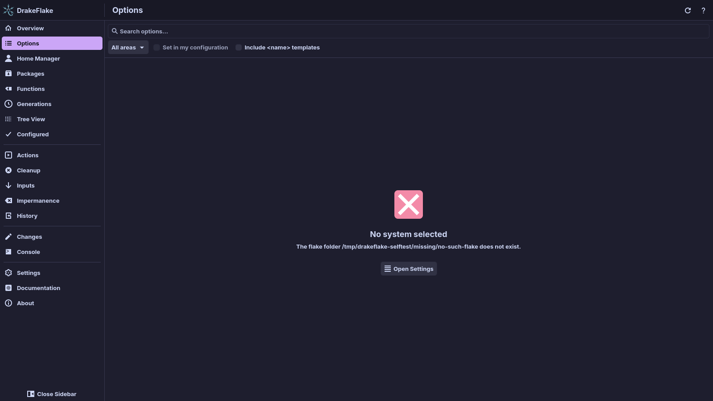

# Troubleshooting

This page lists problems you may run into, what causes them and how to fix
them. Start with the quick fixes. Most problems show up there first.

## Quick fixes

- Read the **Console**. It shows the output of everything the app runs, and
  the last lines of a failed command usually name the problem. **Copy** copies
  the whole output.
- Read the messages above the list on the **Changes** page. They warn you when
  something would keep your changes from working.
- Check **Settings → System**. **System flake:** and **Host:** must point at
  your system. Click **Use this system** after changing them.
- Click **Reload data** in **Settings → System** to read options, values and
  packages again.
- Click **Rebuild caches** in **Settings → System** when search results or
  values look wrong. It forgets the cached indexes and the list of hosts and
  evaluates everything again. This takes as long as
  [the first start](#the-first-start-is-slow).
- Look at [the log file](#the-log-file). Set **Log detail** to
  **Debug: every command run** to see every command the app runs.

## "No system selected"

**Symptoms**

- The pages show "No system selected" with the reason.

**Cause**

The app cannot read your flake or host, for example because the folder does
not exist or the flake does not evaluate.

**Solution**

1. Click **Open Settings**.
2. Check **System flake:** and **Host:**.
3. Click **Use this system**.



## "The flake does not import the generated file"

**Symptoms**

- The **Changes** page warns "Your configuration does not import … yet".
- Applying stops with "Not rebuilding: the flake does not import …. Add it to
  the imports of host "…" first (Save only still works)."

**Cause**

Your changes only take effect when your host configuration imports the
generated file.

**Solution**

1. Open the configuration of your host, for example `configuration.nix`.
2. Add the generated file to its `imports`, for example
   `imports = [ ./drakeflake.nix ];`. The path is relative to the file that
   contains the import. If the output is a folder with a `default.nix`, import
   the folder.
3. Save the file. If your flake is a git repository and the generated file is
   new, make sure git tracks it. The app does this when it writes the file.
   Otherwise click **Track in git** on the **Changes** page.
4. Open **Settings → Setup assistant…** and use **Check import** on the last
   step to confirm. See [the setup assistant](setup.md#3-import).

**Prevention**

If you change the file layout or the output location, the name of the entry
file may change (`drakeflake.nix` or a folder's `default.nix`). The Console
tells you which import to use.

## "… is not tracked by git, so the flake cannot see it"

**Symptoms**

- The **Changes** page shows this warning with a **Track in git** button.

**Cause**

Flakes ignore files git does not track.

**Solution**

1. Click **Track in git** on the **Changes** page.
2. Or run `git add --intent-to-add` on the file yourself.

## "This flake is not a local directory, so it cannot import the generated file"

**Symptoms**

- The **Changes** page warns "This flake is not a local directory, so it
  cannot import the generated file. Point Settings at a local checkout."

**Cause**

The system flake in Settings is not a folder on this machine. The app writes
its generated files into the flake folder, so it needs a local checkout.

**Solution**

1. Check out your flake into a local folder.
2. Open **Settings → System** and set **System flake:** to that folder.
3. Click **Use this system**.

## "… is outside the flake"

**Symptoms**

- The **Changes** page warns that the generated file "is outside the flake"
  and that the generated settings will not be used.

**Cause**

**Output file:** in Settings points to a file outside the flake folder. Flakes
can only import files inside their own folder, so your configuration cannot
import it unless you evaluate impurely.

**Solution**

1. Open **Settings → System**.
2. Set **Output file:** to a path inside your flake folder, or leave it empty
   for the default, `drakeflake.nix` next to `flake.nix`.
3. Click **Use this system**.

## "Staged values do not match their option type"

**Symptoms**

- The **Changes** page shows "… staged value(s) do not match their option
  type. Fix or unstage them to apply."
- You cannot apply.

**Cause**

Staged values are checked against the option's type in the background. At
least one of them failed that check.

**Solution**

1. Find the change in the list. The result of the type check is shown under
   each option.
2. Click the option to open its details and fix the value, see
   [Searching and changing options](options.md).
3. Or click the undo button at the end of its row to unstage it.

## Only "Save only" is offered

**Symptoms**

- The **Changes** page says "This is a nix-darwin host. On this Linux machine
  it can only be saved." or "This is a NixOS host. On this Mac it can only be
  saved."
- Only **Save only** is in the toolbar, and the rebuild buttons are hidden.

**Cause**

A host can only be built and activated on the kind of system it describes.

**Solution**

1. Click **Save only** to write the generated files.
2. Copy or push the flake to the other machine and apply it there.

See [Hosts of the other platform](darwin.md#hosts-of-the-other-platform).

## Applying failed

**Symptoms**

- The banner above the **Console** says **Failed. Check the output below.**

**Cause**

The build or the switch failed. The **Console** shows its output, and the last
lines usually name the problem.

**Solution**

1. Read the last lines in the **Console**.
2. Click **Restore previous file** on the **Console** page to put the
   generated file back as it was before the apply.
3. To go back further, use the **History** page, see
   [History and restoring](applying.md#history-and-restoring).

If the build itself fails, your running system is not changed. Nothing is
committed to git when the rebuild fails, see
[Automatic commits](applying.md#automatic-commits).

> **Note:** **Restore previous file** only writes the generated file back. It
> does not rebuild. Apply again to use the restored settings.

## "Could not write domain" when applying on a Mac

**Symptoms**

- Applying fails after the administrator dialog. The **Console** ends with
  lines like these:

```text
system defaults...
sandbox_extension_issue_file failed for /Library/Preferences/SystemConfiguration/com.apple.smb.server.plist: 1 (Operation not permitted)
Error: Could not write domain /Library/Preferences/SystemConfiguration/com.apple.smb.server; exiting
```

**Cause**

macOS protects some preference files with Full Disk Access, and root alone
is not enough to write them. The activation DrakeFlake starts through the
administrator dialog does not have that access. `system.defaults.smb.*`
(for example `system.defaults.smb.NetBIOSName`) writes such a file.

The build succeeded and the system profile already points at the new system.
The activation stopped half way, so settings after the failing one are not
applied yet.

**Solution**

1. Remove the option the message names from your configuration. For
   `com.apple.smb.server` that is everything under `system.defaults.smb`.
2. Apply again. The activation now runs to the end.

To keep the option, apply from a terminal app that has Full Disk Access
(System Settings → Privacy & Security → Full Disk Access) with
`sudo darwin-rebuild switch --flake <flake>`.

## An input was not updated

**Symptoms**

- The Console says "Not updated: … Nix kept its cached version".

**Cause**

Nix could not get the new revision, usually because GitHub's API rate limit was
reached.

**Solution**

1. Wait a while and update again.
2. Or give Nix a GitHub access token, see
   [GitHub API rate limit](inputs.md#github-api-rate-limit).

## The scan of the root file system fails

**Symptoms**

- The **Impermanence** page shows "Could not list the files with
  administrator rights: …" or "The privileged helper (drakeflake-helper) is
  not installed".

**Cause**

The scan runs as root through the helper. It fails when you cancel the
password dialog, when no polkit agent or `pkexec` is available, or when the
blank snapshot name does not exist on the btrfs file system.

**Solution**

1. Click **Scan again** and enter your password in the polkit dialog.
2. Check the name in **Blank snapshot (btrfs)**. It is the subvolume path
   below the top level of the file system, for example `root-blank`. Leave it
   empty on `tmpfs`.
3. Install the app system-wide so polkit knows its actions (see
   [Installation](installation.md#install-it-system-wide)).

## The banner "This program is older than its interface files"

**Symptoms**

- A banner says "This program is older than its interface files, so some pages
  will not work."

**Cause**

The app's program and its interface files come from different versions, for
example after updating while an old build is still started. Pages would call
functions the program does not have, so the app shows this banner instead.

**Solution**

1. After updating the package, rebuild your system and start the app again.
2. If you run it from a checkout, rebuild it there.

## The first start is slow

**Symptoms**

- The status bar at the bottom shows work for a minute or more.
- The cards on the **Overview** say that something is still loading.

**Cause**

The first time, the app builds an option index from your flake, evaluates the
values of the options your files define and indexes packages. Afterwards the
results are cached in `~/.cache/drakeflake/` and only the parts that changed
are evaluated again. The flake's list of hosts is cached too, until
`flake.lock` or one of the flake's `.nix` files changes.

The status bar may say that some options are skipped because they fail to
evaluate. If many option descriptions fail (often because of the removed
`lib.mdDoc`), building the index is slow.

**Solution**

1. Wait for the first start to finish. Later starts use the cache.
2. If the cache looks wrong, use **Settings → Rebuild caches**.
3. If the **Actions** page recommends fixing option descriptions, fix them to
   speed up the index.

## The window stays empty or the app does not start

**Symptoms**

- The window stays empty, or the app does not start.

**Cause**

Hardware-accelerated drawing does not work on this machine. At start the app
tests whether it can draw a frame and falls back to software rendering by
itself when it cannot. It skips that test when `QT_QUICK_BACKEND` or
`QSG_RHI_BACKEND` is set in the environment.

**Solution**

1. Start the app with `DRAKEFLAKE_SOFTWARE_RENDERING=1 drakeflake` to force
   software rendering.
2. If you set `QT_QUICK_BACKEND` or `QSG_RHI_BACKEND` yourself, start the app
   without them.

## "… not found (set DRAKEFLAKE_QML_DIR)"

**Symptoms**

- The app does not start. The terminal and the log show
  `drakeflake: …/Main.qml not found (set DRAKEFLAKE_QML_DIR)`.

**Cause**

The app cannot find its interface files. It looks for `Main.qml` in the folder
named by `DRAKEFLAKE_QML_DIR`. Without that variable it looks in the folder of
the checkout the app was built in. The installed `drakeflake` command sets the
variable for you. The error appears when the program is started another way,
for example the unwrapped program in the package's `libexec/` folder, or a
build from a checkout that was moved or deleted.

**Solution**

1. Start the app with the `drakeflake` command or the **DrakeFlake** menu
   entry, not the program in `libexec/`.
2. If you run it from a checkout, start it with `nix run .` in that checkout.
3. Or set `DRAKEFLAKE_QML_DIR` to the folder that contains `Main.qml`, for
   example `src/qml` in a checkout.

## Where things are

| What                                                               | Where                                                         |
| ------------------------------------------------------------------ | ------------------------------------------------------------- |
| Settings                                                           | `~/.config/drakeflake/config.toml`                            |
| Log files                                                          | `~/.local/state/drakeflake/*.log`                             |
| Backups of the generated settings                                  | `~/.local/state/drakeflake/backups/`                          |
| Staged changes                                                     | `~/.local/state/drakeflake/staged/`                           |
| Caches (option and package indexes, tried packages, command index) | `~/.cache/drakeflake/`                                        |
| Crash report of the last crash                                     | `~/.cache/drakeflake/crash.log`                               |
| Tray autostart entry (Linux)                                       | `~/.config/autostart/drakeflake-tray.desktop`                 |
| Tray launch agent (macOS)                                          | `~/Library/LaunchAgents/org.dr460nf1r3.drakeflake.tray.plist` |

## The log file

Everything the app does is written to a log file:

- the app: `~/.local/state/drakeflake/drakeflake.log`
- the tray: `~/.local/state/drakeflake/drakeflake-tray.log`

When `XDG_STATE_HOME` is set to an absolute path, the logs are in
`$XDG_STATE_HOME/drakeflake/` instead. Without a usable `HOME`, the app uses a
private folder `drakeflake-<uid>` in the temp dir, and only when that folder
belongs to you and nobody else can enter it. Otherwise it runs without a log
file, backups and cache, and says so. The paths are the same on NixOS and
macOS, and the Linux tray and the macOS menu bar item write the same tray log.

When a log reaches 5 MiB it is rotated. The older logs are kept as `.1`, `.2`
and `.3`, and the oldest one is dropped. Started from a terminal, the app also
prints its log there.

To get more detail, set **Settings → Troubleshooting → Log detail** to one of
these:

- **Debug: every command run** logs every command the app runs.
- **Trace: also full command output** also logs the full output of each
  command.

**Open log** and **Show folder** take you to the file. Passwords you type into
the Console are never logged.

## Still stuck?

Open an issue in the
[DrakeFlake issue tracker](https://github.com/dr460nf1r3/drakeflake/issues)
and include:

- the app version from the **About** page,
- whether you run NixOS or macOS,
- the steps that lead to the problem,
- the **Console** output of the failed command (**Copy** copies all of it),
- the log file, recorded with **Log detail** set to
  **Debug: every command run** while you repeat the steps.

## Related

- [Reviewing and applying](applying.md)
- [Settings](settings.md)
- [Privacy and security](security.md)
- [Frequently asked questions](faq.md)
